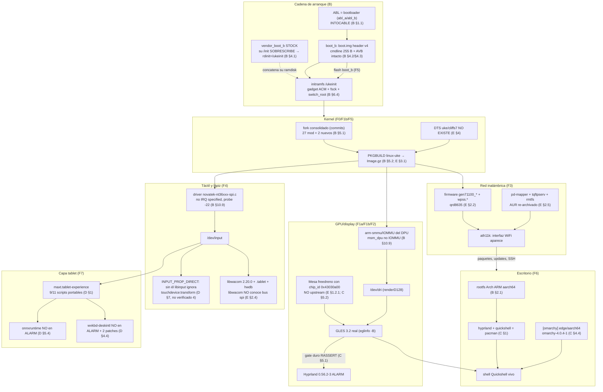

# F — Plan por fases: Omarchy en la Xiaomi Pad 7 «uke» (SM7675/cliffs, aarch64)

> ## ⚠️ Corrección 1-oct-2026 (informe de huellas documentales, `build/gates/revision/V3-huellas-docales.md`)
> Este fichero es el **plan por fases** y su F0 sigue siendo la puerta de entrada, pero su gate
> de sha **ya no es ejecutable literalmente**: verifica `ffff8c51…`/`d2a29ea5…` (el par
> `s244-bounce` + `s229` del 26-sep), que **no está en la tablet** desde el 30-sep. Hoy:
> `boot_b` = **K13-dsid `e0ee47dc…`** + `dtbo_b` = **s260 `6fbb5173…`**, y `boot_a` = K23
> `8e7ed4f9…` + `dtbo_a` = s263 `fe06fccc…` (todo en `build/gates/SHA-BUENOS.txt`, copias en
> `build/backup-par-bueno/`). **El par bueno se lee de `SHA-BUENOS.txt` o de `docs/historia/ESTADO-VIVO.md`, nunca
> de un sha escrito aquí**: cambian en cada ciclo. Además, el F0 tal como está escrito **no
> comprueba la reproducibilidad del kernel**, que era el agujero real y ya está cerrado
> (`ACUMULADO-palawan-d1c7ef2e0-a-k24.diff` + `build/kernel-config/k23b.config` +
> `docs/historia/gates-palawan/build-k23b.sh`: `patch -p1` sobre `git archive d1c7ef2e0` reproduce el árbol byte a
> byte). No se corrige el resto del texto: `F` sigue siendo el plan, y lo que se marca de caducado
> está en V3.

**Subproyecto F** del proyecto *Omarchy en la Xiaomi Pad 7 «uke»*.
**Fecha:** 26-sep-2026 · **Modo:** síntesis. **Nada ejecutado en la tablet.**

> **Qué es este documento y qué no es.** Los informes `A`–`E` ya están cerrados y verificados
> (~327 KB con fuente). Este informe **no investiga nada nuevo**: ordena ese material en fases
> ejecutables, marca dependencias, separa lo predecible de lo experimental, y consolida riesgos.
> **Cada afirmación va con su informe y sección de origen** («(E §1.2)», «(B, riesgo 4)»). Cuando
> dos informes se contradicen, la contradicción se resuelve **en el sitio**, diciendo cuál gana y
> por qué (§9 al final las recoge todas). Lo no verificado y las decisiones del dueño van en §8.

---

## Índice

1. [Resumen ejecutivo](#1-resumen-ejecutivo)
2. [Diagrama de dependencias](#2-diagrama-de-dependencias)
3. [Las fases F0–F8](#3-las-fases-f0f8)
   - [F0 — Higiene y no perder nada](#f0--higiene-y-no-perder-nada-predecible-offline-100)
   - [F1a — Render/GLES sin display (`renderD128`)](#f1a--rendergles--sin-display-devdirenderd128-experimental-pero-0-flashes)
   - [F1b — KMS + panel o82 (`card0`)](#f1b--kms--panel-o82-devdricard0-investigación-la-fase-más-cara-del-proyecto)
   - [F9 — Slot A mudo con imágenes nuevas (bloqueo nº1)](#f9--el-slot-a-no-arranca-imágenes-nuevas-bloqueo-n1-desde-28-sep-2026)
   - [F2 — Mesa/freedreno con el `a732`](#f2--mesafreedreno-con-el-a732-predecible-en-el-hospital--experimental-en-la-tablet-mitad-y-mitad)
   - [F3 — WiFi (WCN6750 + `pd-mapper`)](#f3--wifi-wcn6750--wpss--pd-mapper-predecible-en-el-empaquetado-experimental-en-la-selección-de-variante)
   - [F4 — Táctil + lápiz](#f4--táctil--lápiz-experimental-el-driver-predecible-el-empaquetado)
   - [F5 — PRIMER BOOT DE ARCH EN LA TABLET](#f5--primer-boot-de-arch-en-la-tablet-el-objetivo-de-la-fase-1)
   - [F6 — Hyprland + Quickshell + Omarchy](#f6--hyprland--quickshell--omarchy-predecible-instalable-experimental-usable)
   - [F7 — Capa tablet y lápiz en Omarchy](#f7--capa-tablet-y-lápiz-en-omarchy-experimental-por-definición)
   - [F8 — Producto](#f8--producto-predecible-salvo-el-marcado-de-slot)
4. [Camino crítico y paralelización](#4-camino-crítico-y-paralelización)
5. [Tabla de riesgos consolidada](#5-tabla-de-riesgos-consolidada)
6. [Orden de construcción de paquetes](#6-orden-de-construcción-de-paquetes)
7. [Definición de éxito por fase (checklist)](#7-definición-de-éxito-por-fase-checklist)
8. [Lo no verificado y decisiones pendientes del dueño](#8-lo-no-verificado-y-decisiones-pendientes-del-dueño)
9. [Contradicciones entre informes, resueltas](#9-contradicciones-entre-informes-resueltas)

---

## 1. Resumen ejecutivo

1. **Qué es el proyecto.** Llevar **Omarchy 4 «Quattro»** (Arch + Hyprland 0.56 con config **Lua** +
   shell **Quickshell**) a la **Xiaomi Pad 7 «uke»** (SM7675/`cliffs`, aarch64, Adreno 732,
   táctil Novatek NT36532 por SPI, lápiz Focus Pen, 12 GB, panel Novatek o82 dual-DSI), sobre el
   **kernel propio mainline `7.2.0-rc2-palawan+`** (fork `palawan-mainline/linux`) y **arrancando por
   `boot.img` de Android** con slots A/B — sin UEFI, sin Limine, sin re-particionar (B §1.1).
2. **El hallazgo que abarata el proyecto:** el árbol de Omarchy es **agnóstico de arquitectura** (461
   scripts bash, **cero ELF**; 186 QML; 22 temas) y hay **repo aarch64 publicado** (A §2.1, §1). El
   problema nunca fue portar Omarchy: era el **repositorio de paquetes**.
3. **Dónde está el objetivo Omarchy en la secuencia: al final, y por eso está bien puesto.** Omarchy
   solo es instalable sobre una base que **arranque, tenga disco, tenga red y tenga GPU**. Eso son
   **F0→F5**. Omarchy entra en **F6** y se vuelve usable en **F7**. Nada de F6-F8 se puede adelantar
   sin las fases anteriores (excepto el empaquetado, que sí — §4).
4. **Los cuatro cuellos de botella que deciden el calendario** (por orden de dureza, y son de
   **dependencia**, no de esfuerzo):
   - **(1) `/dev/dri` no existe** — `msm_dpu … no IOMMU, bailing out` (B §9/§10.9). Sin KMS no hay
     display ni GPU. **Bloquea F2, F6, F7 y toda la sesión gráfica.**
   - **(2) Adreno 732 (`0x43030a00`) no está en Mesa upstream ni en `mesa-26.2.3`**: `grep -c` = **0**
     en `main` y en el tag (E §2.3, riesgo R1). Hay parche comunitario (lfdevs PR #93). Sin él,
     Hyprland **aborta** (`RASSERT` en `OpenGL.cpp:228` sin GLES 3.2/3.0, C §5.1).
   - **(3) `pd-mapper` no está en Arch ARM** (404) y sin él el ath11k **no obtiene la placa**: la
     interfaz WiFi no aparece (E §1.2.3, §2.5).
   - **(4) El fork del kernel tiene 27 ficheros modificados + 2 sin trackear sin commitear** — entre
     ellos `qcom_battmgr.c` (carga de batería), `ufs-qcom.c` (UFS), `ath11k` y `swiotlb`: empaquetar
     desde el `.git` **pierde casi todo** (B §5.1, riesgo #1).
5. **Lo que NO es cuello de botella, contra la intuición:** Hyprland (`0.56.2-3`) y Quickshell
   (`0.3.1-1`) **ya están en Arch Linux ARM `extra/aarch64`** (C §1, §4.1) y el escritorio
   (`omarchy 4.0.4` / `omarchy-settings 4.0.4`) **ya está publicado para aarch64** en
   `pkgs.omarchy.org/edge/aarch64` (A §1; C §4.4). `pacman` los instala: **cero compilación**.
6. **El trabajo nuevo de verdad son cinco cosas** (E §1.1): kernel propio (PKGBUILD + DTS `uke`),
   firmware que Linux no distribuye (`gen71100_*`, `wpss.*` — fuente ya localizada), el **parche de
   Mesa** del 732, la **definición de lápiz** (libwacom + hwdb, con la trampa del bus SPI), y
   **`pd-mapper`** (+ `tqftpserv`/`rmtfs`) re-archivado desde AUR.
7. **La incógnita real no es el escritorio: es la capa tablet.** El propio port de Fydetab la declara
   «fase abierta» y **ningún port de Omarchy la ha resuelto** (A §4, §8.8; C §7.1). Hay base sólida
   (`maxt.tablet-experience` es ~85-90 % reutilizable, D §1) y dos bloqueos concretos
   (`onnxruntime`, `wvkbd-deskintl` — D §12).
8. **El proyecto tiene una red de seguridad y una regla dura.** Red: el par bueno en slot **b** (hoy `boot K13-dsid` + `dtbo s260`; antes `s240-mem2g` + `s229`,
   y antes `s244-bounce` + `s229`: **el par bueno se lee de `SHA-BUENOS.txt`**), y el par bueno puede ponerse en **ambos** slots
   (B §7, Fase 0.2). Regla: **R1/R11 — solo `fastboot set_active` cambia el slot**; editar attrs de
   GPT por `dd` **causó el brick del 11-sep-2026** (B §8.1). Y `vbmeta` **no se toca** (B §4.3).
9. **Estado hoy:** la tablet arranca Ubuntu con el kernel #82, sin `/dev/dri` ni `/dev/input`;
   `misc` con BCB sucio; `userdata` ext4 con ~908 errores; en fastboot **no carga** (umbral GO
   ≥ 3700 mV) (B §9, riesgos 2/3/4/5).
10. **La estrategia entera cabe en una frase:** *cambiar el rootfs (Ubuntu → Arch ARM) y la pieza que
    lo monta (`ukeinit` → initramfs de Arch), conservando entre el 80 % y el 90 % del arranque que ya
    funciona* (B §1.1). Todo lo demás es reutilizar el pipeline de Fydetab cambiando tres cosas
    (A §9): blobs de arranque, PKGBUILD del kernel y overlay de hardware.

---

## 2. Diagrama de dependencias

### 2.1 Grafo (mermaid)



### 2.2 Cadena de bloqueo, en texto (lo que hay que memorizar)

```
boot.img (cabecera + cmdline + rdinit=/ukeinit)  →  TODO
        └─ kernel palawan (FORK CONSOLIDADO)  →  GPU/display, táctil, firmware, WiFi
                kernel + IOMMU  →  /dev/dri  →  GLES 3.2
                        Mesa con a732  →  GLES 3.2
                                GLES 3.2 + /dev/dri  →  Hyprland 0.56  →  Omarchy
        └─ firmware gen71100_* y wpss.*  →  ath11k
                pd-mapper (+tqftpserv/rmtfs)  →  placa del ath11k  →  WiFi
                        WiFi  →  instalar paquetes cómodo, actualizar, SSH (no bloquea el arranque)
        └─ driver NT36532 + /dev/input  →  táctil
                INPUT_PROP_DIRECT  →  libinput acepta touchdevice:transform  →  rotación con calibración
                        táctil + OSK  →  capa tablet usable  →  Omarchy tablet de verdad
```

### 2.3 Las tres reglas de dependencia que hay que respetar (y por qué)

| Regla | Consecuencia si se ignora |
|---|---|
| **El kernel consolidado va antes que cualquier paquete** | empaquetar desde el `.git` pierde `qcom_battmgr.c` (batería), `ufs-qcom.c` (UFS), `ath11k`, `swiotlb`, el panel o82 y el táctil (B §5.1) → un kernel que arranca **sin nada** de eso |
| **`/dev/dri` + GLES 3.2 antes de Hyprland** | Hyprland no arranca *en absoluto*: `RASSERT(false, "EGL: failed to create a context with either GLES3.2 or 3.0")` (C §1, §5.1). El fallo típico en Qualcomm+ARM es **kernel/DTB que no expone la GPU**, no Mesa (C §6.6) |
| **El táctil antes de la capa tablet** | sin `/dev/input` no hay gestos, ni rotación con calibración, ni rotación táctil; `texp-touch` no encuentra device y sale con error (D §11.1) |

---

## 3. Las fases F0–F9 (F9 añadida 28-sep-2026: bloqueo nº1)

> **Convención.** Cada fase lleva: **Objetivo · Criterio de «hecho» (comando + salida esperada) ·
> Prerrequisitos · Pasos · Riesgos · Evidencia a recoger · Informes que la sustentan**. Además:
> **¿Predecible o experimental?** y **¿Qué se puede hacer sin la tablet?**

---

### F0 — Higiene y no perder nada (**predecible · 100 % offline salvo los pasos 5-7**)

**Objetivo.** No perder el trabajo de 30 commits + 30 ficheros sin commitear, no perder el par que
arranca, y no empezar con el disco y el BCB en un estado que sabotea la fase siguiente.

**Por qué va primero (y no es trámite).** Tres deudas se cobran *aquí*: (a) el **riesgo #1** del
proyecto es de método — si se empaqueta el kernel desde el `.git` se pierde casi todo el estado del
working tree (B §5.1); (b) el `misc` tiene grabado `reboot-bootloader`, así que **el próximo reinicio
puede caer a fastboot** (B §1.1, riesgo 4), y **en fastboot la tablet no carga** (riesgo 2); (c) el
`userdata` ext4 acumula errores en cada reinicio y eso rompe SSH/TLS antes de que nada de lo demás
importe.

> 🆕 **Reescrita el 27-sep-2026 con el estado real medido** del árbol y del ledger del hermano
> (#442). Los números que la versión anterior daba («29 commits + 27 ficheros») están desfasados, y
> **hay una trampa nueva que la versión anterior no veía**.

**Estado real medido (27-sep-2026, sin tocar la tablet).**

| Dato | Valor |
|---|---|
| Rama | `s150-postclk`, último commit `07ca40a0b` («s168: prevlog publica la firma real…») |
| Commits | **30** |
| Sin commitear | **30 entradas: 28 `M` + 2 `??`** |
| DTS `uke` | 🟢 **existe**: `xiaomi-uke.dts`, 556 líneas, **trackeado**, commit `27a08bc20`, en el `Makefile:46` |
| Drivers nuevos | `panel-xiaomi-o82-dualdsi.c` (681 líneas) y `novatek-nt36xxx-spi.c` (657) — los 2 `??` |
| Gates de config | ✅ ya construidos: `configs-uke/{opciones-criticas,simbolos-criticos}.txt` + `nuevo-build-bueno.sh` |
| `CONFIG_QCOM_PD_MAPPER` | 🟢 `=m`, ya activo (cambia F3, no F0) |
| Tarball consolidado | ❌ **no existe** (risk #1 sigue abierto) |
| `bcb-clean.bin` | ⚠️ **2048 B**, y la imagen de limpieza que B §4.5 documenta son **8192 B** (la **partición** `misc` son **4 MiB**: B:36, :403, :1133) ⇒ **el artefacto es la cuarta parte** |

**🚨 La trampa de F0 (nueva, 27-sep-2026; precisada 28-sep-2026 en `build/gates/DECISION-misc-BCB.md`).**
`~/gpu-work/bcb-clean.bin` son **2048 bytes de ceros** (verificado: `stat` = 2048,
`tr -d '\0' | wc -c` = 0 ⇒ todo ceros) y **ningún script lo usa**. B documenta **dos cosas
distintas**: la partición `misc` son **4 MiB** (B:36, :403, :1133) y la imagen de ceros
`misc.img` son **8192 B** (B:414, :875; con contradicción interna en :874, que da `bs=4096
count=1` = 4096 B). **Flashear un fichero parcial y dar por limpio el BCB deja el resto intacto
con falsa sensación de arreglo** — y eso vale tanto para los 2048 B como para flashear 8192 B en
una partición de 4 MiB. ⇒ **Medir `blockdev` en el aparato y decidir según
`DECISION-misc-BCB.md` (recomendación: 4 MiB enteros); verificar el tamaño de la partición en el
propio aparato, no de palabra en `B`.**

**Prerrequisitos.**
- 🟢 **Semáforo del proyecto hermano**: el ledger iba por **#442** con la ronda 10e **en vuelo**.
  **No commitear a ciegas el `~/gpu-work` compartido ni escribir nada en la tablet** sin confirmar
  que no hay sesión viva. Los pasos 1-4 tocan el árbol compartido:Coordinar con el dueño.
- Tabla de 4 `slot-retry-count` leída **antes** de nada.
- Batería **≥ 3700 mV** si se va a escribir en la tablet (pasos 5-7).

**Pasos.**

**Grupo A — offline, sin tablet, riesgo ≈ 0 (hazlos primero).**
1. **Commitear el fork por temas**, sin canonizar experimentos abiertos. Los 28 `M` se agrupan:
   `pd_mapper + pmic_glink + battmgr + ufs-qcom + swiotlb` | `ath11k/{ahb,ahb.h,hal,qmi}` |
   `gpu/a6xx + adreno + msm_gpu + dispcc + interconnect` | `panel-o82 + nt36xxx` (los 2 `??`) |
   `runtime.c + uke-panic-fb` (los *pokes*, detrás de su CONFIG) | `xiaomi-uke.dts`.
   ⚠️ **`ath11k/hal.c` lleva el experimento `s248` con veredicto abierto** (ledger #439/#441: el
   parche hace lo que dice — 0 escrituras a los MSI — pero el reset persiste ⇒ «el MSI no es el
   gatillo»). **Decidir explícitamente: se commitea como `ath11k: s248-nomsi (experimento, veredicto
   abierto)` o se revierte a stock.** No se commitea en silencio: si no, un hack queda como historia
   oficial y `s248` se cuela en el kernel de F5.
   ⚠️ `drivers/base/power/runtime.c` tiene el parche de debug del port que **inundaba la consola**
   (miles de líneas/s → `sshd` trabado, ledger #427). **No debe ir al kernel de producción.**
2. **Tarball consolidado y verificación de que compila desde él** (esta es la cierre del risk #1):
   ```bash
   cd ~/gpu-work/palawan-linux
   tar --exclude=.git --exclude='*.o' --exclude=.tmp* -cJf ~/linux-palawan-7.2.0rc2.tar.xz .
   sha256sum ~/linux-palawan-7.2.0rc2.tar.xz | tee ~/gpu-work/TARBALL.sha256
   mkdir -p /root/build-test && tar -xJf ~/linux-palawan-7.2.0rc2.tar.xz -C /root/build-test
   # build SIEMPRE desprendido y con MAKE/ARCH explícitos (si no, el make es un no-op):
   cd /root/build-test && setsid nohup env MAKE=/usr/bin/make ARCH=arm64 \
     CROSS_COMPILE=aarch64-linux-gnu- LLVM=1 sh -c 'make -j$(nproc) Image.gz modules dtbs' \
     > /root/build-test.log 2>&1 &
   ```
   **Criterio: el log tiene que mostrar líneas de compilación reales y terminar con `Kernel: arch/
   arm64/boot/Image.gz is ready`. Un «OK» vacío es un no-op, no un build.**
3. **Regenerar la imagen de ceros AL TAMAÑO QUE DIGA `blockdev`, no al que diga el plan**
   (ver `build/gates/DECISION-misc-BCB.md`, 28-sep-2026: la partición son 4 MiB según B y el 8192
   del plan no tiene ancla en medición del aparato; recomendación vigente: **4 MiB enteros**,
   `build/misc-zeros-4m.img` ya generado y verificado todo-ceros):
   ```bash
   # 1) el tamaño REAL de la partición, desde el aparato (no de B ni de F):
   #    ls -l /dev/disk/by-partlabel/misc ; blockdev --getsize64 /dev/disk/by-partlabel/misc
   #    dd if=/dev/disk/by-partlabel/misc bs=4096 count=1 | od -A d -t x1z  # estado del BCB hoy
   # 2) con ese tamaño exacto (si blockdev da 4194304, usar el artefacto de 4 MiB tal cual):
   dd if=/dev/zero of=build/misc-zeros-4m.img bs=1M count=4 conv=fsync
   stat -c '%s' build/misc-zeros-4m.img     # → 4194304
   sha256sum build/misc-zeros-4m.img
   ```
4. **Backups que no tocan la tablet**: `cp` de los artefactos del par bueno
   (`avb/boot-s244-bounce.img`, `dtbo-gpu/s229-boot-dtbo-wifi-wpss.img`) a un directorio con fecha, y
   `SHA-BUENOS.txt` con sus sha. Los sha ya son conocidos y registrados: `ffff8c5126…` y `d2a29ea5…`
   — **comprobar que coinciden** en vez de fiarse del texto.

**Grupo B — requieren la tablet (overnight, con presupuesto).**
5. **Backup del par bueno en disco, por SSH, y en ambos slots.** ⚠️ **`fastboot fetch` sin verificar
   en este ABL** (REFUTADO B-01) y **no hay `adb`** en la tablet (es Ubuntu). El canal que funciona es
   SSH + `dd` + relectura (patrón ledger #241):
   ```bash
   # por SSH a la tablet, por contenido y no por letra de /dev/sdX (REFUTADO R-49):
   P=/dev/disk/by-partlabel/boot_b
   [ -b "$P" ] || { echo "ABORT: no existe $P"; exit 1; }
   dd if="$P" of=/root/boot_b-lee.img bs=1M count=96 conv=fsync
   dd if=/dev/disk/by-partlabel/dtbo_b of=/root/dtbo_b-lee.img bs=1M count=16 conv=fsync
   sync
   ```
   Y en el PC, **hasheando al tamaño exacto de la imagen** para anular el pad de ceros de 96 MB:
   `head -c <bytes-de-la-imagen> boot_b-lee.img | sha256sum` → debe dar el sha que pone
   `build/gates/SHA-BUENOS.txt` para el par vigente (el `ffff8c5126…` que ponía aquí es el de
   s244-bounce, superado el 26-sep: **no comparar contra shas de un informe**).
6. **Limpiar el BCB de `misc`** según la decisión de `build/gates/DECISION-misc-BCB.md`
   (recomendación: **4 MiB enteros** tras confirmar `blockdev`; el paso 6 sigue **PENDIENTE**, nada
   flasheado a 28-sep-2026), y **releer al tamaño completo flasheado** — no solo los 4 KiB:
   `command[0:32]` en ceros es necesario pero no suficiente (el criterio de 4 KiB no vería un resto
   sucio más allá del offset escrito). Pre-registrar el sha en el ledger **antes** de escribir.
7. **`e2fsck` en frío sobre `userdata`**: `e2fsck -f -y -D <por-partlabel>` y luego una segunda
   pasada, ambas en `rc=0`. ⚠️ sobre 105,9 GB puede tardar **mucho** y su duración **no está medida**
   (B §10.6/§10.12): lanzarlo desprendido, con tiempo y con el cargador de pared.
8. **Poner el par bueno en el slot `a`** (`fastboot set_active a` y volver a `b` después) para que una
   caída a fastboot no deje la tablet sin arranque conocido. Registrar los 4 `slot-retry-count` antes
   y después.
9. **Línea base de rendimiento** (solo lectura): `systemd-analyze` actual como marca a batir
   (referencia: 25.356 s, `multi-user.target` a los 896 ms) e inventario de firmware
   (`find /lib/firmware | wc -l`; referencia del hermano: 422 ficheros / 46 MB) para dimensionar el
   paquete de F3.

**Criterios de «hecho» (medibles).**
```bash
cd ~/gpu-work/palawan-linux
git status --porcelain | wc -l                      # → 0 (o la lista explícita de lo que se dejó abierto)
git log --oneline | wc -l                           # → 30 + los commits nuevos de F0
grep -c . /root/build-test.log                      # → > 1000  (un build vacío = no-op)
test -f /root/build-test/arch/arm64/boot/Image.gz && echo "IMAGEN OK"
stat -c '%s' build/misc-zeros-4m.img                 # → 4194304 (tras confirmar blockdev; ver DECISION-misc-BCB.md)
sha256sum avb/boot-s244-bounce.img dtbo-gpu/s229-boot-dtbo-wifi-wpss.img   # HISTORICO (26-9): ffff8c51… / d2a29ea5…
sudo e2fsck -f -y -D <userdata> ; echo rc=$?        # → rc=0, dos pasadas seguidas
fastboot getvar all | grep slot-retry-count         # → los 4 registrados, antes y después
```

**Riesgos.**
- 🔴 **Colisión con el proyecto hermano**: `~/gpu-work` es compartido y el paso 1 toca 30 ficheros.
  Con #442 en vuelo, commitear sin avisar deja el árbol en un estado que la otra sesión no espera.
- 🔴 **La trampa del `misc` de 2048 B**: flashearlo deja 6 KB de BCB viejo y aparenta haber arreglado
  el problema.
- 🟡 **`e2fsck` sin tiempo medido** sobre 105,9 GB, y con la tablet sin RTC el reloj va atrasado.
- 🟡 **Escribir en la tablet** consume reintentos de slot y, en fastboot, **no carga** (≥ 3700 mV).
- 🟡 **Build en primer plano = no-op silencioso**: sin `setsid nohup` + `MAKE=` explícito, un «OK»
  vacío es indistinguible de un build real.

**Evidencia.** `git log` del fork + la lista de lo que se dejó abierto · sha del tarball + del log de
build con su recuento de líneas · `SHA-BUENOS.txt` con los sha del par bueno · salida de
`fastboot getvar all` (los 4) antes y después · salida de `e2fsck` ×2 · el `misc` releído (4 KiB) ·
filas del ledger del hermano para cada escritura.

**Informes.** B §5.1 y §7 (Fases 0/2.1/6.1), B riesgos 1/2/3/4/5/12/18/19 · E §2.2 y §3.3 ·
`REFUTADO.md` B-01, R-49 · `docs/historia/AGENTS.md` §Reglas y §Presupuesto.

**Sin la tablet.** Los pasos 1, 2, 3 y 4 son íntegros offline: el commit del fork, el tarball con su
build de verificación, el `misc` regenerado y los backups locales. **Eso es el 70 % de F0 y el 100 %
del riesgo #1.**

**Decisiones de dueño.**
- **D1 (sin cambios):** ¿se commitea en `s150-postclk` o se abre una rama `uke` limpia desde
  `palawan/v7.2-rc2`? **Con 30 commits encima, la respuesta obvia es seguir en `s150-postclk`** (abrir
  rama ahora no separa nada: el trabajo sin commitear es el mismo).
- 🆕 **D17:** ¿el experimento `s248` de `ath11k/hal.c` se commitea con etiqueta de «veredicto
  abierto» o se revierte a stock antes de F5? **Recomendación: revertir a stock** — la ronda 10e
  sigue viva y commitear un `.ko` a medio camino solo complica el diagnosis.
- 🆕 **D18:** ¿los *pokes* de diagnóstico (`uke-panic-fb`, `prevlog`, `uke-poke.h`,
  `runtime.c` con el log de debug) van en la rama principal o en una rama `diag` aparte? **El
  `runtime.c` con miles de líneas/s no debe estar en el kernel de F5** (fue lo que trabó `sshd`).

---

### F1a — Render/GLES **sin display** (`/dev/dri/renderD128`) (**experimental, pero 0 flashes**)

> 🆕 **Fase partida el 27-sep-2026** a partir de la antigua F1. Motivo: F1 mezclaba **dos frentes
> distintos** — el SMMU del display (que *wedgea el arranque*) y el firmware del GMU (que *cuelga en
> runtime*) — y los trataba como uno solo, cuando uno es barato y el otro es el más caro del
> proyecto. **F1a desbloquea F2; F1b no bloquea nada.** Ver «Por qué se partió» en F1b.

**Objetivo.** Que exista `/dev/dri/renderD128` **sin KMS**: que el driver `msm` registre la GPU como
componente propio (`separate_gpu_kms`), que el GMU arranque, y que `eglinfo` reporte **`freedreno`**
aunque sea en modo surfaceless. **No** se busca un píxel en el panel.

**Por qué es el gate correcto.** El bloqueo de `-ENODEV` está en `msm_kms.c:198`
(`drm_info(dev, "no IOMMU, bailing out"); return ERR_PTR(-ENODEV);`) y **solo afecta a la ruta KMS**
— upstream master es idéntico, no hay bypass ni parche. Con `separate_gpu_kms=1`
(`msm_drv.c:57-66`, `msm_gpu_no_components()`) la GPU se registra en un driver `msm_kms_driver`
separado, **sin DPU y sin el IOMMU del display**. El proyecto de origen **ya lo logró una vez**
(24-sep: `G2-initOK`, `[drm] Initialized msm 1.13.0`, `/dev/dri/card0+renderD128`).

**Lo que de verdad bloquea F1a: el cuelgue del CM3.** `a6xx_gmu_start` (`a6xx_gmu.c:292`) hace
SYSRESET=1 → log-wptr → SYSRESET=0, y el **primer `readl` del sondeo de `CM3_FW_INIT_RESULT` no
vuelve**: cuelgue duro de bus del AP, sin oops, sin panic, sin pstore. Lo que **sí** está verificado:
el firmware carga entero en TCM (`fw-map icache iova=0x4000`), el OPP del GMU está bien, y relojes /
MMIO / RSC están bien. Hipótesis viva (**H1**): el primer acceso del CM3 (icache/dcache vía *su*
SMMU, SID 5) deja el puente colgado; línea concreta a mirar: `IOMMU_PRIV` en `a6xx_gmu.c:1611`
frente a `qcom_adreno_smmu_init_context` (que solo prepara TTBR1/PRR para SID 0).
⚠️ **Esto NO es el fallo de GMU conocido upstream**, que es `"GMU firmware initialization timed
out"` (con mensaje y retorno `-ETIMEDOUT`). El nuestro no imprime nada: es un *hang* de bus, otra
categoría, y por eso no hay parche upstream que aplicar.

> 🆕 **Dependencia CM3 declarada (28-sep-2026): F1a DEPENDE de que el CM3 esté sano — no es un paso
> más, es la puerta.** Si el CM3 cuelga en el primer `readl` de `a6xx_gmu_start()`, habrá
> `renderD128` pero **NO** GLES ⇒ F1a **fallido** aunque el nodo exista. Orden obligatorio: (1) usar
> la escalera CM3 en caliente (`build/cm3-ladder/measure-cm3.sh`, sin flash; harness 3/3 verde
> re-ejecutado 28-sep-2026, ver `build/cm3-ladder/INFORME-CM3.md`) y solo después (2) pedir GLES.
> Límite honesto: a nivel AXI, "el bus no decodifica este registro" y "el dispositivo no responde"
> son indistinguibles (ambos = un `readl` que no vuelve); se desambigua por contexto, no por la
> línea. H1 (primer fetch del CM3 por SID 5) archivada por R-57 del hermano.
> El dtbo F1a **`s252`** está construido y gateado pero **SIN FLASHEAR**: sha
> `c3677f95…`, 607 674 B, +1/-0 sobre s238 (`status = "disabled"` en
> `display-controller@ae01000`), constructor `build/bootimg/mkdtbo-s252.py` (gates G0–G9, G8
> autoprobado con 4 mutaciones peligrosas rechazadas, idempotente por pieza), procedimiento de medida `build/gates/diag-f1a.sh`.
> Recordatorio: el criterio de «hecho» es `eglinfo -B` diciendo `freedreno`, no la existencia del
> nodo.

**Prerrequisitos.** `dmesg -n 7` (los `UKE-CM3DBG` son KERN_INFO de nivel 6 y desaparecen con el
nivel por defecto) · consola ACM armada **antes** de empezar · el `dtbo s249` (`3cad90b0…`, master
DRM deshabilitado) para no arrastrar el oops del desmontaje DRM que contaminaba el bind.

**Pasos.**
1. **Desbloquear el bind del clon del nodo GPU** por configfs con el `s249` (arranque sano, sin el
   `-19` del display). El clon ya se sabe crear; lo que falla es el `bind`, con `-EBUSY` = guardia
   `dev->driver != NULL` (ledger #432). Con el master DRM deshabilitado, el oops que lo contaminaba
   desaparece por construcción.
2. **Aislar el cuelgue**: ¿cuelga en el SYSRESET, en el log-wptr o en el primer `readl`?
   Instrumentar **con `UKE-POKE` en el arranque**, nunca en runtime.
3. **Probar la variante SID 5 / `IOMMU_PRIV`** (línea H1). Antes: leer qué pide exactamente
   `qcom_adreno_smmu_init_context` y si el nodo GMU declara su propio SMMU en el DT.
4. Solo si 1–3 no mueven nada: **comparar contra un kernel que ya traiga la GPU de fábrica**
   (Android/KGSL) para ver si el CM3 arranca fuera de mainline. Eso separa «mainline está mal» de
   «el ABL/TZ no suelta el CM3», que son dos proyectos distintos.

**Criterios de «hecho» (medibles).**
```bash
ls -l /dev/dri/renderD128                            # → existe (sin card0: eso es lo esperado)
eglinfo -B 2>/dev/null | grep -A2 "OpenGL ES profile"   # → vendor "freedreno"
eglinfo --display-surfaceless -B                    # → aunque sea surfaceless: GLES 3.2
dmesg | grep -c "no IOMMU"                           # → 1 es NORMAL aquí (aborta la ruta KMS, no la GPU)
# y sobre todo: NO hay cuelgue → el probe llega a "ready" y sobrevive 300 s
```
⚠️ **El criterio es `eglinfo`, no la existencia del nodo.** `/dev/dri` puede existir sin GPU usable
(lección del hermano: master DRM a medias, `adreno` OK, sin card). Un `renderD128` sin
`eglinfo` → `freedreno` es un F1a **fallido**.

**Riesgos.** El cuelgue del CM3 **no es recuperable solo** (el watchdog del `s229` no está arreglado,
R-42) ⇒ cada intento puede necesitar **reset físico**. Mitigación: cargador de pared, `powersave`
después de arrancar, y **≤ 2 intentos por sesión** (presupuesto en `docs/historia/AGENTS.md`). Dato a favor: la
tablet «vuelve sola» tras el cuelgue si el watchdog del APSS está vivo (medido), así que no siempre
hace falta el reset.

**Sin flashes.** Todo es en caliente: crear/quitar el clon por configfs y reintentar el probe. **Es la
razón de ser de F1a.**

**Evidencia.** `dmesg` capturado **a fichero por SSH, no solo por consola** (la de 115200 pierde la
cola al cortar el reset: así se produjo el «sin `-EIO`» falso del ledger #428 → #429) · `eglinfo`
completo · fila del ledger con el punto exacto de muerte.

**Informes.** B §10.9, riesgos 3/14 · C §5.1 · sesión 24-sep de GPU · ledger #432, #440, #441.

---

### F1b — KMS + panel o82: `/dev/dri/card0` (**investigación: la fase más cara del proyecto**)

**Objetivo.** Que el DPU obtenga IOMMU, el panel `o82` se inicialice y haya KMS real: modos del panel,
`backlight > 0` y **un píxel en la pantalla**.

**⚠️ Por qué se partió F1.** La antigua F1 («cerrar GPU/display: `/dev/dri`») mezclaba: (a) el
`apps-smmu` que **wedgea el arranque** — falsado dos veces (bisección #418 con `s214`/`s217`/`s222`, y
el ciclo #431 con `s241`+`s244`: ni una línea de consola, contador 7→0, caída a fastboot); (b) el
**cuelgue del CM3** (que ahora es F1a); y (c) el **DTS `uke` con el panel o82**, que no existe.
Llamarla «la fase menos predecible» era correcto, pero por razones equivocadas: lo impredecible ya no
es «qué falla» sino el nudo (a), que además es **el único del proyecto que puede dejar la tablet en
fastboot sin cargar**. F1b no bloquea F2 ni F3; F1a sí.

> 🆕 **28-sep-2026 tarde — el nudo (a) se reabre: el dtbo NO está agotado como vía.** El ciclo de
> aislamiento (`boot_a` = kernel de pokes `11cf3482…` + `dtbo_a` = **s238 bueno**, sin s251) dio el
> **CUARTO arranque mudo** (0× `UKE-POKE` tras la línea 315533 del log, rollback limpio al par bueno;
> resultado en `build/gates/PRE-REGISTRO-F5-B1.md`). El s251 queda **inocente de los mudos con boot
> nuevo**; lo común a los 4 es una imagen de `boot` nueva en el **slot A** (ver **F9**, bloqueo nº1).
> La medición del wedge del s251 en slot B con kernel bueno (11:52–12:03, 7→0) sigue en pie, pero su
> interpretación ("enlazar `apps-smmu` es el problema" / "espacio dtbo cerrado") vuelve a hipótesis
> abierta: el mecanismo común no tiene nombre (forense en curso). **No reflashear s251 sin causa
> nueva** (cerrojo en `mkdtbo-s251.py`), pero **tampoco archivar la vía dtbo**.

**Estado real (verificado en el ledger del proyecto de origen, no en los informes A–G).**
- El **arreglo B** (dominio de traducción por defecto) **ya está aplicado al árbol** desde el 25-sep
  20:55 y lo llevan `s224`, `s227`, `s230`, `s244`. **No existe «A sin B»** con los boots modernos.
- El nodo `apps-smmu` del `dtbo` del vendor declara `compatible = "qcom,qsmmu-v500"` (**sin fallback
  a `qcom,smmu-500`**) y **dos regiones `reg`** (`0x15000000 + 0x100000` y `0x151fe000 + 0x40`, esta
  última `reg-names = "tcu-base"`). El binding upstream (`arm,smmu.yaml`) pone `maxItems: 1`, así que
  el nodo **viola el binding**; pero el driver base mapea solo el recurso 0, o sea que **la segunda
  `reg` es inerte en runtime: no es el bug**. Los 8 hijos `qcom,qsmmuv500-tbu` **no los lee nadie**
  en mainline (el único consumidor, `arm-smmu-qcom-debug.c`, usa otro `compatible`).
- Hipótesis principal del wedge: **los registros TCU no son accesibles desde el NS** (propiedad de
  hyp/TZ, programados por el firmware vía `qcom,handoff-smrs`) ⇒ el primer `readl` (IDR0) en
  `arm_smmu_device_probe` cuelga el bus. **[HIPÓTESIS, no verificada.]** No se ha encontrado parche
  upstream 2025-2026 sobre «apps_smmu two reg» ni sobre este wedge.

**Pasos (en este orden).**
1. 🟢 **Experimento decisivo, a coste de hardware casi nulo**: arrancar **`s244` + `s241`** (el watchdog
   de 30 s con el `reg` de 2 celdas ya está construido) y leer el **`prevlog`/ramoops del arranque
   anterior** para obtener el **PC de muerte**. Si apunta a la lectura del IDR0 en
   `arm_smmu_device_probe` ⇒ hipótesis TCU confirmada ⇒ el camino A/A′ queda cerrado y solo queda el
   cartucho del paso 5. **Es lo único que puede hacer avanzar la causa sin hipótesis nuevas, y el
   hardware para hacerlo ya está pagado.**
2. **Rellenar la capa de display del DTS `uke`** — 🟢 **ya existe**, no hay que escribirlo desde cero
   (corrige a E §4, que decía lo contrario): `arch/arm64/boot/dts/qcom/xiaomi-uke.dts`, **556
   líneas**, trackeado, commit `27a08bc20`, y **en el Makefile** (`Makefile:46`) con
   `compatible = "xiaomi,uke", "qcom,lamma"`. Sus propios comentarios (líneas 518-536) listan lo que
   falta: `&mdss { status = "okay" }`, `&mdss_dsi0` + `panel@0` con el o82, `&mdss_dsi1` (status ok +
   `assigned-clock-parents dsi0-phy`), `&mdss_dsi0_phy`/`dsi1_phy` con `vdds-supply`, y los grupos de
   reguladores. Los drivers **también existen**: `panel-xiaomi-o82-dualdsi.c` (681 líneas) y
   `novatek-nt36xxx-spi.c` (657 líneas), ambos entre los **2 ficheros sin trackear** → F0 los
   commitea. ⚠️ El backlight de este panel es **DCS 0x51 interno del panel**, no un `backlight` de
   kernel ⇒ el criterio de F1b tiene que mirarlo, no solo `brightness`.
   ⚠️ `gpio-shared-proxy.ko` **no está instalado** en el árbol ⇒ sin él VSP/VSN no registran
   (ledger #410): sin esto, el panel falla con «can't get GPIO».
3. **Gate `fdtoverlay` + `bin/uke-dtbo-check.py` en verde antes de cada flasheo de `dtbo`.** Un overlay
   con un phandle por etiqueta o un `__local_fixups__` colgado wedgea el arranque (rondas 35.7/36.2).
4. **No tocar `dtbo_b` ni `vendor_boot_b`** sin DT propio: sustituir `vendor_boot` **rompió el
   arranque** (ledger #238, «el fork moría ANTES del pintor») y el `dtbo` del vendor cubre rieles del
   panel, `gpucc` y watchdog (B §1.1, §4.6, riesgo 11). ⚠️ **Matiz frente a la antigua F1**: aquella
   versión «prohibía» trabajar con el `dtbo`; el método que produjo *todos* los avances del hermano
   fue **iterar con `dtbo`**, no reemplazarlo. Lo que estaba prohibido era tocar `vendor_boot_b`, y eso
   se mantiene.
5. **Último cartucho, solo si el SMMU es propiedad de hyp/TZ** (y solo tras confirmar el paso 1):
   parche local a `msm_kms_init_vm` que acepte un dominio IDENTITY preexistente en vez de `-ENODEV`.
   El DPU puede operar con direcciones físicas si el SMMU se deja en bypass. **Marcado como lo que
   es**: parche fuera de upstream, frágil, y solo para desbloquear F1b en este ABL. **[NO PROBADO.]**

**Sobre el «DT propio» (3-8 días según B Anexo B).** Existe el prototipo `avb/boot-m1-modern-dt.img`
(header v2 + DTB único appended, sha `99781d55…`) y es el camino para prescindir del `dtbo` del
vendor. ⚠️ No es gratis: tiene el caveat de la ronda 27 (gates sobre el DTB extraído; el traspaso de
splash solo ocurre en el PRIMER arranque tras el flash). **Decisión de dueño (D2)**, con recomendación
**cambiada a «después»**: con el `dtbo` del vendor como base, el DT propio es una *optimización*, no
un prerrequisito — y el hermano lleva dos semanas justamente en no poder prescindir de él.

**Criterios de «hecho» (medibles).**
```bash
ls -l /dev/dri/                          # → card0 + renderD128 (KMS de verdad)
dmesg | grep -cE 'msm_dpu.*no IOMMU'      # → 0
cat /sys/class/drm/card0-DSI-1/modes      # → modos del panel o82 (NO el vfb 640x400)
# el backlight del o82 es DCS 0x55/0x51 interno del panel, NO un backlight de kernel:
cat /sys/class/backlight/*/brightness     # → puede no existir; el gate real es la foto
# + FOTO del panel con un patrón: un `modes` con contenido, sin foto, es medio gate
```

**Riesgos.** El wedge del `apps-smmu` **deja la tablet en fastboot sin cargar** (umbral GO ≥ 3700 mV,
R17/R44) · ⚠️ **`qcom,palawan-dpu` es aportación del fork** (`dpu_kms.c:1514`): upstream master **no**
lo tiene, así que un rebase al master puro **pierde el soporte de display** · el watchdog del `s229`
no está arreglado (R-42) ⇒ sin recuperación automática · kernel > 35 MB no cabe antes de
`SIG_OFF=35438592` · instrumentación que inunda la consola.

**Presupuesto (nuevo, no negociable).** F1b es la fase que más traga. Reglas en `docs/historia/AGENTS.md`
§Presupuesto: ≥ 3700 mV, cargador de pared, `powersave` tras arrancar, ≤ 2 escrituras/día, vigía de
fastboot apuntando al par bueno, `dmesg -n 7`, y **techo de 3 ciclos por hipótesis** (al tercero sin
movimiento en `dmesg`, la hipótesis pasa a `REFUTADO`, no se intenta un cuarto flash).

**Evidencia.** `prevlog`/ramoops con el PC de muerte (paso 1) · `dmesg` por SSH a fichero **y**
consola · `ls -l /dev/dri`, `modes`, `brightness` · foto del panel · sha256 del `boot.img` probado ·
fila del ledger.

**Informes.** B §1.2, §4.2-§4.3, §6.3-§6.4, §7 Fase 9, §10.9, riesgos 9/11/14/15 · E §2.1, §3.2,
§4 · C §5.1 · sesión 24-sep GPU · ledger #410, #418, #426, #431, #432, #440.

**Sin la tablet.** El DTS `uke` se puede **escribir** y el DT propio **compilar**; lo que no se puede
es validarlos.

**Decisión de dueño:** ¿DT propio antes o después de Omarchy? (D2; la recomendación ha cambiado a
«después».)

---

### F9 — El slot A no arranca imágenes nuevas (**bloqueo nº1 desde 28-sep-2026**)

> 🆕 **Fase añadida 28-sep-2026.** Hasta hoy no figuraba en ningún sitio y es lo que más bloquea:
> sin poder arrancar un kernel nuevo en slot A no se puede iterar F1a/F1b/F3.

**Objetivo.** Averiguar por qué el slot A queda mudo con imágenes de `boot` de nueva factura, con el
slot B intacto como red.

**Medición que la abre (4/4 mudos, variable aislada).** Tres intentos flashearon a la vez boot nuevo
+ dtbo s251 y quedaron mudos; el cuarto (aislamiento, `build/gates/PRE-REGISTRO-F5-B1.md` resultado)
puso `boot_a` = pokes `11cf3482…` + `dtbo_a` = **s238 bueno** y también quedó mudo: 0× `UKE-POKE`,
1× `Linux version` del kernel bueno (rollback). El s251 queda inocente; lo común es **boot nueva en
slot A**. El hermano falla cuando mete la nueva en `dtbo`, siempre en slot B (su #431). Mecanismo
común sin nombre: **forense en curso** — su candidata es `vendor_boot_a`/`init_boot_a` **vacías**
(borradas por `erase` el 24-sep y nunca restauradas; el borrado sí verificado en su ledger #384;
script sin commitear `build/gates/ciclo-restaurar-slot-a.sh`, **NO verificado por mí**: ni el estado
de ceros actual, ni su cita "#336 = `vendor_boot` es la base del DT" (el #336 trata de otra cosa),
ni el rechazo a reempaquetados más allá del título del #272).

**Lo que ya se sabe y acota la búsqueda (28-sep-2026):**
- `fastboot getvar unlocked` = **`unlocked: yes`** (gates del ciclo de aislamiento,
  `PRE-REGISTRO-F5-B1.md`): el bootloader **no impone verificación AVB** ⇒ el hashtree reempaquetado
  es decorativo y el digest `ba30b5f7…` que no cuadra ni con la imagen que arranca es lo normal, no
  una rareza. Medido en `build/gates/AVB-Y-VBMETA.md` (repetible con `build/gates/medir-avb.sh`):
  vbmeta_a == vbmeta_b (`0f7399d9…`, 131072 B), hueco kernel→firma byte-idéntico al de `boot_b`.
- Los pokes UKE-POKE **nunca llegaron a ejecutarse en ningún intento**: el cuelgue ocurre antes de que
  exista consola (`ttyGS0` lo crea el gadget USB del init, inexistente en un `arch_initcall`), por eso
  el 3er intento dio cero líneas. Instrumentar el probe del SMMU era prematuro; vbmeta/hashtree no era
  la vía.
- Regla de captura: hubo **dos lectores** de `/dev/ttyACM0` a la vez (PID 5347 y 77586, reapertura el
  mismo segundo tras re-enumerar USB; tramo 14:11–15:01 contaminado,
  `build/gates/REGLA-UN-SOLO-LECTOR.md`). "No hay líneas en consola" es **indicio, no prueba**: los
  veredictos se apoyan en datos independientes (contadores de slot, versión del kernel, `qbootctl`).

**Criterio de «hecho».** Un `boot_a` nuevo arranca hasta `Linux version` en consola (aunque el probe
falle después con mensaje): eso separa "slot A rechaza la imagen" de "el kernel cuelga".

**Evidencia.** Consola ACM (un solo lector) + `getvar all` (los 4 contadores) antes/después +
`qbootctl` del arranque resultante. **Informes:** B §4.2–§4.3 (AVB), `AVB-Y-VBMETA.md`.

---

### F2 — Mesa/freedreno con la GPU de la uke (**🟢 el parche probablemente NO hace falta**)

**Objetivo.** Que `eglinfo -B` reporte **`freedreno`** y **GLES 3.2** (no `llvmpipe`), requisito
absoluto de Hyprland.

**Prerrequisitos.** **F1a** (que exista `/dev/dri/renderD128` con la GPU viva). Ya **no** F1b: F2 no
necesita KMS.

> 🟢 **RESUELTO POR LECTURA DE CÓDIGO el 27-sep-2026 — la incógnita 2 de §8.1 queda cerrada, y el
> resultado cambia el plan.** La fase se llamaba «Mesa con el a732» y su riesgo (R3) era «sin el parche
> no hay GPU». **Eso era una hipótesis, y es falsa tal como está montado el árbol:**
>
> 1. **El kernel NO lee el chip ID del silicio.** `find_chipid()`
>    (`drivers/gpu/drm/msm/adreno/adreno_device.c:143`) parsea el **string `compatible` del DT** con
>    `sscanf(compat, "qcom,adreno-%08x", chipid)`.
> 2. El DT del fork declara `compatible = "qcom,adreno-43030b00"`
>    (`arch/arm64/boot/dts/qcom/palawan.dtsi:2371`) — una **declaración heredada de
>    palawan/SM8635 (735)**, contradicha por el propio `arch/arm64/boot/dts/qcom/lamma.dtsi:71`
>    (`compatible = "qcom,adreno-gmu-732.0"`).
> 3. ⇒ **Lo que el kernel reportará es `0x43030b00` (FD735)**, y tanto el catálogo del kernel
>    (`adreno/a6xx_catalog.c:1618`, con fw `gen71100_*`) como **Mesa `main`**
>    (`freedreno_devices.py`, `GPUId(chip_id=0x43030B00, name="FD735")`) **ya lo conocen**.
>
> **Consecuencias:**
> - ✅ **Con el árbol tal como está, Mesa NO necesita parche.** R3 se desactiva. El `mesa` de ALARM
>   (`1:26.2.3-1`, medido 26-sep-2026) sirve tal cual.
> - ⚠️ **«Corregir» el DT a `0x43030a00` (el 732 real) NO es un cambio de una línea: son tres.**
>   `grep -c 0x43030a00` sobre `drivers/gpu/drm/msm/**` = **0** hoy, así que sin **añadir antes la
>   entrada en el catálogo del kernel** (`adreno_info()` devolvería NULL y la GPU **no se añadiría**
>   al component-match) el resultado sería **perder la GPU**. Orden correcto: catálogo → DT → parche
>   de Mesa, y probarlo con F1a (que no necesita display).
> - 🤔 La declaración `b00` es **una mentira que funciona**: el silicio es un 732 (SM7675), y el
>   parche lfdevs PR #93 añade justamente `0xffff43030b00` como fallback «any speedbin» con la idea
>   de «732 = 735 bineado». Es decir, Mesa upstream **ya contempla** que un 732 se anuncie como 735.
> - 📌 **Decisión de dueño (nueva, D15)**: ¿se deja la mentira (`b00`, cero parche, cero riesgo
>   extra) o se hace honesta (catálogo + DT + parche: 3 piezas, más trabajo, sin mentira)?
>   **Respuesta por defecto: «dejarla»**, y no tocar el DT hasta que F1a esté verde.
>
> - **[NO VERIFICADO en silicio]**: la lectura del registro GPU_ID real. La conclusión es por
>   lectura de código + convergencia de specs, muy sólida, pero falta el cierre en la tablet.

**Pasos.**
1. 🟢 **F2 se reduce a `pacman -S mesa vulkan-freedreno` desde ALARM.** No hace falta repo propio ni
   parche. `mesa` de ALARM: **`1:26.2.3-1`** (medido 26-sep-2026 en
   `archlinuxarm.org/packages/aarch64/mesa`); `vulkan-freedreno` (Turnip) también está en `extra`.
2. **Preparar (no aplicar) el parche lfdevs PR #93** como plan de contingencia: sigue siendo la
   referencia documentada de las características del 732 (`a7xx_gen2`, `num_ccu=3`,
   `tile_align_w=96`). Mergeado 28-jul-2026 en
   `github.com/lfdevs/mesa-for-android-container#93`. ⚠️ Ese fork usa backend **KGSL** (contenedor
   Android), **no DRM/MSM**: de ahí se copia el `.py`, **nunca sus binarios** (coherente con E §3.4).
   **Versionado** en el mini-repo propio: la fuente avisa que el soporte de 710/720/732/735
   *«has been removed and restored more than once»* (E §2.3).
3. **Confirmar el chip ID en silicio** cuando haya GPU viva: `cat /sys/kernel/debug/dri/*/device` o
   el log de `msm`. Esperado `0x43030b00`. **Si saliera `0x43030a00`, vuelve el plan del parche.**
4. Si se decide la vía honesta (D15), **no se hace aquí**: es una subtarea de F1a/F1b con su propio
   criterio de éxito (`/dev/dri/renderD128` presente + `eglinfo` con freedreno **después** del cambio).

**Criterios de «hecho».**
```bash
eglinfo -B 2>/dev/null | grep -A2 "OpenGL ES profile"   # → vendor "freedreno", "OpenGL ES 3.2"
eglinfo --display-surfaceless -B                        # → GLES 3.2 aunque sea surfaceless
vulkaninfo | grep -E 'deviceName|apiVersion'            # → Turnip (opcional, buena señal)
# + una app real: un triángulo no es un compositor a 2136x3200. Registrar glmark2-es2 como línea base.
```
⚠️ **`eglinfo` es el criterio, y la cifra de rendimiento también.** La uke es una GPU de gama media
en un panel 3K, y eso condiciona F6 más que la propia existencia de GLES.

**Riesgos.** ⚠️ **R3 de F §5 queda RETIRADO** (el parche no es necesario tal como está el árbol) ·
queda el riesgo de que la 732 se comporte como 735 y algo falle (genuino: son silicios distintos, y
el parche lfdevs existe porque alguien lo probó) · mezclar Qt/Mesa a mano rompe cadenas (C §2.4,
§7.3) · los builds Turnip de terceros son solo para validar, nunca paquete final.

**Evidencia.** `eglinfo -B` completo (surfaceless y normal), `chip_id` reportado por el kernel, el
número de `glmark2-es2`, y `vulkaninfo`.

**Informes.** C §1, §5.1-§5.2, §6.6, §7.1, §8 · E §1.2.1, §2.3, §3.4, R1 · `docs/historia/ESTADO-VIVO.md`.

**Sin la tablet.** Prácticamente todo: es la fase más barata que queda.

---

### F3 — WiFi (WCN6750 + WPSS + `pd-mapper`) (**🟢 la más cerca de cerrarse; ~90 % hecha, no empezada desde cero**)

**Objetivo.** Que aparezca la interfaz WiFi, se associate y **no se resetee**.

**Por qué es dependencia dura y por qué es F3 y no F6.** Sin red, instalar los paquetes de Omarchy en
la tablet es incómodo (aunque **posible**), y quedan fuera SSH, NTP (el reloj ya va ~2 días atrasado
sin RTC, B riesgo 13) y las actualizaciones. Omarchy **no** necesita WiFi para instalarse desde un
repo, pero el proyecto **sí** la necesita para ser un dispositivo usable.

> 🟢 **REESCRITA el 27-sep-2026 con la evidencia del ledger del proyecto de origen (#424–#442).**
> La versión anterior partía de que «la variante de `wpss.mbn` no está decidida» y que «el `-EIO` del
> CE de ath11k» era el bloqueo. **Las dos cosas ya no son verdad.** Ver «Estado real» abajo.

**Estado real (medido, no supuesto).**
- 🟢 **El `-EIO` del CE está RESUELTO** (ledger #433): el parche que ignora `swiotlb=noforce` con un
  **pool swiotlb como fallback** da `mapped [mem 0xe7000000-0xeb000000]` (64 MB, por debajo de 4 GB) y
  **cero `overflow` / `-EIO`**. ⚠️ Ojo: el «sin `-EIO`» del #428 era un **artefacto de la consola de
  115200**, que pierde la cola al cortar el reset; repetido con `dmesg -w` capturado por SSH sí se ve
  (#429). **Criterio de método: doble captura.**
- 🟢 **La cadena de firmware llega hasta `qmi firmware ready` + rings + HTC**: el chip **responde**
  (`chip_id 0x1 chip_family 0xb board_id 0xff soc_id 0x40140120`,
  `WLAN.MSL.3.0-00642-QCABMSLSWPLZ-1.81982.7.102970.2`), el WPSS está arriba
  (`remote processor wpss is now up`) y el staging de la tablet == el instalado (16 ficheros, sha
  verificados, #434). ⇒ **La variante de `wpss.mbn` es un ítem cerrado: se resolvió empíricamente.**
  (R-47 del hermano: rutas planas `ath11k/WCN6750/hw1.0/`.)
- 🔴 **El bloqueo actual es otro: un reset silencioso del WLAN a los ~7,33 s del inicio del probe**
  (**4/4 en banda**: 7,319 / 7,333 / 7,350 + **r10e Δ=7,397 s**). r10e (pre-registro hermano #442) **se
  ejecutó el 26-sep 22:58 sin acta**; medida recuperada 28-sep de
  `~/proyectos/out/wifi-{dmesg,trace-pipe}-r10e.log` (no existe `ramaa/s21/out/`):
  muerte **0,387 s** tras `qmi firmware start`, último write **CON retorno**, cal 6,138 s, `cal`
  ausente no fatal. Criterio #442: **ÉXITO del temporizador; SORPRESA descartada** (s248 no sobrevive
  con carga tardía). Acta propuesta para su ledger en `build/gates/R10E-NOTA.md`.
  **Conclusión: temporizador del firmware del WPSS (CORROBORADA 4/4), no el driver.** El reorden
  MSI→base ya estaba REFUTADO (`s247`, su #437); el MSI entero, rematado por `s248` (#441).
- ⚠️ **Cuidado con la no-persistencia y con el gasto de slots**: `uke-wifi-trace.sh:46` borra la
  blacklist de ath11k y **no la restaura** ⇒ udev autocarga el módulo por modalias antes de que
  `pwrseq` esté listo ⇒ **el probe se queda en `-EPROBE_DEFER` y se gastan reintentos de slot**
  (ledger #441 §1). Blacklist + `sync` obligatorios.
- 🟢 **`pd-mapper` no hace falta empaquetarlo**: `CONFIG_QCOM_PD_MAPPER=m` **ya está activo** en
  `~/gpu-work/palawan-linux/configs-uke/config-bueno-actual.config` (Kconfig en
  `drivers/soc/qcom/Kconfig:75`, módulo en `drivers/soc/qcom/Makefile:10`). Upstream existe desde la
  serie v7 (abr-2024). El `pd-mapper` de AUR pasa a plan B. Lo que **sí** hay que empaquetar es el
  **firmware** (y `tqftpserv`/`rmtfs`, que no tienen equivalente in-kernel).
- ℹ️ **Sobre ath11k vs ath12k**: el config bueno trae **`CONFIG_ATH11K=m` y `CONFIG_ATH12K=m`**, y el
  dispositivo carga **`ath11k_ahb`**. La ruta ath11k de esta fase es la correcta.

**Prerrequisitos.** Kernel con `ath11k` + `qcom_pd_mapper` disponibles · firmware en su sitio ·
blacklist de ath11k **horneada en la imagen** (con `sync`) · `mem=2048M` mientras siga el tema del
swiotlb · cargador de pared.

**Pasos.**
1. **PKGBUILD de firmware propio** (`uke-firmware` / `qcom-sm7675-firmware`), recorte recomendado
   (E §3.3): `qcom/gen71100_gmu.bin` (80 680 B), `gen71100_sqe.fw` (67 348 B), `gen71100_zap.mbn`
   (12 088 B), `qcom/wpss.mdt + wpss.b00…b12`, `qcom/adsp.*` (opc.), `qca/msbtfw12.*`/`msnv12.*`
   (**variante 12, no 11**), `ath11k/WCN6750/hw1.0/{board-2.bin,Notice.txt}`.
   **Regla dura:** **NO depender** de `linux-firmware-qcom` de Arch ARM: pesa **537 MiB** y **aun así
   no trae `gen71100_*`** (E §2.2, riesgo R4). ✅ **El recorte ya está validado empíricamente** por el
   hermano (los 16 ficheros con sha verificados) ⇒ copiar su lista, no reinventarla.
2. ~~**Resolver la variante de `wpss.mbn` ANTES de empaquetar**~~ ✅ **CERRADO** (ver «Estado real»):
   la cadena llega a `qmi firmware ready` con el firmware instalado. **Acción:** documentar la lista
   exacta de ficheros y su sha en el paquete (heredada de #434), no volver a investigar la ruta.
3. ~~**`pd-mapper` re-archivado desde AUR**~~ 🟢 **DEGRADADO A PLAN B**: cargar `qcom_pd_mapper` (ya
   compilado en el kernel). `tqftpserv`/`rmtfs` sí hay que empaquetarlos desde AUR, y re-archivarlos
   **no es obligatorio como decía E**: hoy declaran aarch64 (`pd-mapper 1.1-1` con
   `arch=(aarch64 x86_64)`, `qbootctl` con `arch=($CARCH)`, `wvkbd-deskintl` y `lisgd` con
   `'aarch64'`). ⇒ **R5/R6 de F §5 y R2/R6 de E: degradar de «obligatorio» a «verificar por
   paquete».** El caso `pinta linux-x64` de A:334 sigue siendo un ejemplo real de que *algunos* PKGBUILDs
   vienen en x86, pero no estos.
4. **No repetir el muro del `swiotlb`**: el bootconfig del `vendor_boot` stock mete
   `swiotlb=noforce`; el árbol tiene el parche que **lo ignora** (`kernel/dma/swiotlb.c:199-212`, marca
   `UKE: se ignora`) y el `boot.img` **exige** esa marca por aserción (B §5.3, Fase 4). **NO usar
   `swiotlb=force`**: con `force_bounce`, `dma_map_resource()` con `DMA_ATTR_MMIO` falla y **muere el
   mapeo MSI de ath11k** (B §5.4, riesgo 16). 🟢 **Y ya no hace falta el «plan B» del pool: el
   hermano tiene el pool funcionando (64 MB < 4 GB, cero `-EIO`, #433). Reutilizar su parche tal cual.**
5. ⚠️ **`mem=2048M`: la condición de salida que la versión anterior ponía ya no existe.** Se decía
   «se lleva `mem=2048M` hasta que el swiotlb se cierre» → **el swiotlb está cerrado desde #433** y sin
   embargo `mem=2048M` sigue puesto (coste medido: `MemTotal 1645140 kB` = 1,6 GB de 8 nominales).
   **Decisión pendiente (nueva, D16):** ¿se sube a `mem=3900M` o similar, o se acepta la pérdida?
   Recordar que `mem=` **no** elimina el banco de RAM por encima de 4 GB
   (`880000000-88b9cefff`), que es lo que provocaba el `-EIO` (ESTADO-ACTUAL). Con el pool swiotlb
   por debajo de 4 GB, el argumento de `mem=2048M` ya no se sostiene. **Es una decisión de dueño, no
   técnica, y cuesta 1,6 GB de RAM en F6.**
6. **Blacklist + `sync` de ath11k, horneadas en la imagen** (no en runtime): con ella, el módulo no se
   autocarga por modalias y se controla la carga explícitamente. Ver `docs/historia/AGENTS.md` regla 9.
   🆕 28-sep-2026: blacklist verificada con `build/gates/instala-blacklist-ath11k.sh` (11 ok + gate 6:
   la imagen **NO** la contiene aún → rebuild pendiente), paquete de firmware WLAN de 16 ficheros con
   `build/gates/paquete-firmware-wlan.sh` (24 ok), parche MSI archivado como registro refutado
   (`build/gates/patches/wlan-msi-orden.diff` + `aplicar-parche-msi.sh`), procedimiento de medida
   `build/gates/medir-wlan-reset.sh` (pendiente validar en vivo).
   El WiFi **NO depende de `apps-smmu`**: corre en bypass con `dma-direct` y pool swiotlb de 64 MB
   hasta `qmi firmware ready` + anillos, y muere en reset a los 7,33 s (NOTAS 28-sep-2026, F3).

**Criterios de «hecho» (medibles).**
```bash
ls /lib/firmware/qcom/gen71100_*         # → 3 ficheros: gmu.bin, sqe.fw, zap.mbn
lsmod | grep -E 'qcom_pd_mapper|ath11k'  # → ambos presentes (mapper desde el kernel, no AUR)
ip link | grep -E 'wlan|wlp'             # → interfaz presente
nmcli dev status                        # → "wifi  <dev>  connected"
nmcli dev wifi list | tail -n +3         # → > 0 redes  (sub-criterio de calidad)
dmesg | grep -cE '\-EIO|overflow'        # → 0, con dmesg capturado POR SSH a fichero
iperf3 -t 60                             # → sin reset del WLAN durante 60 s
uptime                                   # → sigue subiendo tras 300 s (el reset es a ~7,33 s)
```
⚠️ **`ip link` con la interfaz presente NO es WiFi usable**: el fallo actual es un reset a los 7,33 s,
que deja la interfaz  appearing durante segundos y luego la tumba. **El criterio que importa es
«sobrevive 300 s» y `nmcli dev status` = `connected`, no la existencia del nodo.**

**Riesgos.** 🔴 El reset de ~7,33 s es **el** bloqueo; causa **CORROBORADA 4/4** (temporizador de
firmware/TZ, r10e incluida) · R4 (no depender de `linux-firmware-qcom`) · R2/R6 **degradados**
(los AUR críticos ya son aarch64) · el fork `palawan-mainline` está parado desde el 9-jul-2026
(riesgo R26) · R29: reloj sin RTC (~2 días de atraso) rompe SSH/TLS mientras no haya NTP ⇒
`fake-hwclock` con guardado periódico desde el día 1 de F5.

**Evidencia.** `ls` del firmware instalado con sha · `dmesg` completo capturado por SSH (no solo
consola) · `ip link`, `nmcli dev status`, `nmcli dev wifi list` · `iperf3` · `uptime` a los 300 s · y el
`%FILENAME%` del paquete de firmware propio.

**Informes.** E §1.2.3, §1.3, §2.2, §2.5, §3.3 · B §4.6, §5.4, §10.8, riesgos 14/16/17 ·
ledger #424, #428, #429, #433, #434, #441, #442 · `docs/historia/ESTADO-VIVO.md`.

---

### F4 — Táctil + lápiz (**experimental el driver, predecible el empaquetado**)

**Objetivo.** `/dev/input/event*` con el táctil NT36532 **y** con el lápiz; y que el táctil exponga
`INPUT_PROP_DIRECT` para que libinput acepte `touchdevice:transform`.

**Por qué importa más de lo que parece.** Dos de los tres riesgos «de tablet» del proyecto se pagan
aquí: (a) la **rotación con calibración sincronizada** —que es una línea (`texp-rotate:80-83`) pero
que **libinput ignora** si falta `INPUT_PROP_DIRECT` (D §7, no verificado 4); (b) la **presión del lápiz**,
que se captura con **GTK4 puro** (`Gtk.GestureStylus` + `Gdk.AxisUse.PRESSURE`), **sin el shell de
Omarchy** (D §5.2).

**Prerrequisitos.** **F1b** (kernel/DT que enumere el bus SPI y el IRQ del táctil) — o al menos el
DTS `uke` con el bus del táctil, que se puede escribir sin cerrar el display.

**Pasos.**
1. **Driver `novatek-nt36xxx-spi.c` con soporte de lápiz** — está entre los **2 ficheros sin trackear**
   del fork (B §5.1) → F0 lo commitea. Hoy el kernel dice
   `novatek-nt36xxx-spi spi0.0: no IRQ specified` y `probe … failed with error -22` (B §10.9).
   El parche de referencia para el **pen** es el de **NT36523** (mencionado en el enunciado del proyecto
   y en la documentación base `informe-stylus-linux-2026.md`, **citado en E §2.4 pero no disponible
   en esta máquina** — ver el aviso del README).
2. **Verificar `INPUT_PROP_DIRECT`** (D §7, no verificado 4):
   `cat /sys/class/input/eventN/device/properties` → **bit 1 puesto**. Sin él,
   `input:touchdevice:transform` puede ser ignorado por libinput (mecanismo confirmado en
   `drawing/knowledge/libinput-rotation-and-left-handed.md:16-28`, D §7) y **la rotación con
   calibración no funcionará por mucho que se copie el script**.
3. **libwacom**: el **binario ya está** en ALARM (`libwacom 2.20.0-1`, E §2.4). Lo que falta es
   (a) la **definición del dispositivo** y (b) que libwacom **entienda el bus**.
   - ⚠️ **Limitación dura:** libwacom **solo conoce `usb`, `serial`, `bluetooth`, `i2c`**
     (`bus_from_str()` en `libwacom-database.c:168-179`); **no hay `spi`** (E §2.4, riesgo R5). Si el
     táctil aparece como `spi` → **parche de 3 líneas**; si aparece como `i2c`/`unknown` → la entrada
     directa vale.
   - Base a copiar: `generic.tablet` (comodín con `IntegratedIn=Display;System;`, `Stylus=true`) o
     `lenovo-ideapad-duet.tablet` (`Class=ISDV4`, `DeviceMatch=i2c|27c6|0e30`, `IntegratedIn=Display;System`,
     `Touch=true`) (E §2.4, §3.6).
   - Ruta con precedencia: **`/etc/libwacom/xiaomi-uke.tablet`** (sobre `/usr/share/libwacom/`).
   - **Regenerar el hwdb** (`libwacom-update-db.py` → `65-libwacom.hwdb`), porque
     `65-libwacom.rules` consulta el **hwdb**, no el `.tablet` (E §3.6, paso 4).
   - **Antes de nada:** recoger el **sysinfo** con el script oficial de `wacom-hid-descriptors`
     (E §2.4 y §6 paso [0]).
4. **hwdb de ejes** en `/etc/udev/hwdb.d/60-evdev.hwdb` — la resolución del eje táctil (E §2.4).
5. **Reglas udev donde udev las lee** (trampa heredada corregida en Arch): las reglas del proyecto
   están en **`/etc/udev/99-uke-*.rules`**, *no* en `/etc/udev/rules.d/` ⇒ **hoy no se aplican** (B §7
   Fase 9). Y para los daemons de la capa tablet hacen falta `SUBSYSTEM=="input", KERNEL=="event*",
   TAG+="uaccess"` + `usermod -aG input` (D §8.5).
6. **Calibrar postura** si se va a usar rotación automática: `texp-orient --watch` girando la tablet
   por las 4 posturas; la tabla de signos del plugin está medida **en un ThinkPad X12** y **el Pad 7
   tendrá montaje y signos distintos** (D §2.2, §11.2).

**Criterios de «hecho» (medibles).**
```bash
ls /dev/input/event*                          # → táctil + lápiz
libinput list-devices | grep -iE 'novatek|touch'   # → device con Size/Calibration
cat /sys/class/input/eventN/device/properties      # → bit 1 (INPUT_PROP_DIRECT) puesto
libinput debug-events --device /dev/input/eventN   # → toques con coords ABS
evtest                                        # tool de validación (evtest ✅ en ALARM, E §2.4)
```
**Sub-criterio de lápiz:** evento de **presión** distinto de 0 y de la presión máxima (0.55×–1.0× de
grosor modulado con presión real, D §5.2).

**Riesgos.** Que el DT no describa el IRQ del NT36532 (hoy `-22`, B §10.9) · `INPUT_PROP_DIRECT` ausente
→ rotación de táctil silenciosamente nula (D §7/§11.4) · libwacom no conoce `spi` (E riesgo R5) ·
los ejes del acelerómetro siguen la convención iio y pueden estar **rotados respecto al montaje real**
(comentario explícito en `texp-orient:90-93`, D §2.2) · no verificado que el driver IIO del SM7675 esté
en el fork (E §5.2).

**Evidencia.** `libinput list-devices` completo, `properties` del device (bit 1 documentado),
`wacom-hid-descriptors` sysinfo, el `.tablet` final + hwdb regenerado, y `evtest` del lápiz con presión.

**Informes.** B §5.1, §7 Fase 9, §10.9, riesgo 1 · E §2.4, §3.6, riesgos R5 · D §2.1-§2.2, §5.1-§5.2,
§7, §8.5, §11.

**Sin la tablet.** El `.tablet` de libwacom **no** se puede finalizar (depende del sysinfo real), pero
sí se puede preparar todo el andamiaje y el hwdb. El **driver** sí se puede trabajar offline (el
parche NT36523 de referencia + el módulo sin trackear).

---

### F5 — PRIMER BOOT DE ARCH EN LA TABLET (**el objetivo de la fase 1**)

**Objetivo.** Que la tablet arranque **Arch Linux ARM** y quede en una sesión SSH con consola serie.
**Sin GPU, sin táctil, sin sesión gráfica.** Eso es F5; Omarchy viene después (F6).

> 🟢 **La buena noticia que hace esto barato y reversible.** El rootfs de Ubuntu **no está «en la
> tablet» sino en un fichero en el PC**: `~/gpu-work/ramaa/s22/rootfs.img` (**8 GiB**, ext4) y su
> forma comprimida `rootfs.img.gz` (**370 MB**), que es exactamente lo que se sirvió por HTTP y se
> escribió con `dd`. **Abandonar Ubuntu NO es un punto sin retorno**: la vuelta atrás es
> `wget | zcat | dd` del mismo `.gz` por el mismo canal, en minutos. Y como se hace por el gadget
> USB, no depende de la WiFi (que está al ~90 %) ni de la batería (que es lo único que se pierde en
> fastboot).

**El principio: no se cambia la cadena de arranque, se cambian dos payloads.**

| Pieza | Qué se hace | Por qué |
|---|---|---|
| `ABL` (`abl_a`/`abl_b`) | 🔒 **intocable** | El brick del 11-sep-2026 |
| `vendor_boot_b` | 🔒 **stock, intocable** | Su `/init` es el que **sobrescribe** y hace que se use nuestro `rdinit`. Sustituirlo rompió el arranque (ledger #238) |
| `dtbo_b` | 🔒 **`s229`, intocable** | Cubre rieles del panel, `gpucc` y watchdog. Además `fastboot boot` usa el dtbo **del slot activo** (R-12) |
| `boot.img` | 🔄 **se rehace**: mismo shell, 2 payloads cambiados | Es lo único que se toca |
| `userdata` | 🔄 **se sobrescribe** con la imagen de Arch | El rootfs es lo único que cambia de verdad |

**Los dos payloads que cambian dentro del `boot.img`:**
1. `arch/arm64/boot/Image.gz` → el **mismo kernel que ya arranca** (el `s244-bounce`, 16.5 MB). En el
   **primer** boot no se compila un kernel nuevo: si el kernel fuera el problema, no sabríamos si
   falla el kernel o el rootfs. Cero variables nuevas.
2. el **initramfs** → el `rdinit` que hace de puente a Arch.

**Grupo A — offline, sin tablet (el ~90 % del trabajo, y su riesgo).**

**A1. El init de Arch: partir del que YA funciona, no escribir uno nuevo.**
Existe y está probado: `~/proyectos/ubuntu-uke/tools/ubuntu-init/init` (**177 líneas**), el
`rdinit=/uke/init` que arranca hoy la tablet. Termina en `exec /sbin/init`, así que **el `switch_root`
a Arch/systemd ya está hecho**. Para Arch solo hay que **quitar** lo que era de Ubuntu/adb:

| Qué | En el init de Ubuntu | En el de Arch | Por qué |
|---|---|---|---|
| Pseudo-FS (`proc`/`sys`/`devtmpfs`) | sí | **igual** | systemd lo exige montado |
| Carga de `.ko` del vendor (`/uke/ko-patched/`, 348 módulos, 2 pases) | sí | **best-effort o fuera** | el kernel del fork tiene ath11k/ufs/panel **in-tree**; los del vendor eran para el 6.1 |
| Espera de UDC (30 s) + `echo $UDC > …/UDC` **lo último** | sí | **igual** | si el UDC se escribe antes de existir el gadget, no funciona (B3a) |
| Gadget **ACM** (`idVendor=0x18d1 idProduct=0xD002`, `functions/acm.GS0`) | sí | **igual** | es la **consola de depuración**, y el CM3 cuelga sin panic: sin ACM no se depura nada |
| `adbd` + espera de `ep0` + 3 reintentos de bind | sí | **fuera** | `adbd` es de Android. En Arch: SSH |
| Red | la de `adbd` | **`rndis.usb0` o `ecm.usb0` + IP estática `192.168.42.129`** | es el canal de depuración y de instalación |
| `e2fsck` antes de montar | no | 🔴 **añadido, obligatorio** | `userdata` arrastra ~880 errores (F0 paso 7) |
| `mount -o move` de los pseudo-FS + `switch_root` | implícito | **explícito** | |
| `exec /sbin/init` | sí | **igual** | systemd de Arch también está en `/sbin/init` |
| `fake-hwclock` con guardado | no | 🔴 **añadido, obligatorio** | **no hay RTC**: sin esto systemd arranca en 1970 y rompe SSH (host key) y TLS |

⇒ **Resultado: un init de ~90 líneas**, y el 80 % de sus líneas ya existen y funcionan en esta tablet.
**Gate: `qemu-aarch64 busybox ash -n ukeinit-arch` en verde, y el `cpio.gz` < 8 MiB** (el actual son
~1 MiB, así que hay holgura de sobra).

**A2. Construir la imagen de Arch ARM exactamente como la de Ubuntu.**
El PC corre **Arch nativo** (`Linux 7.2.6-arch2-1`), así que **`pacstrap` corre sin emular** — esto es
la ventaja de que el host ya sea Arch. El patrón a copiar, medido:
```bash
# 1) imagen de 8 GiB (el mismo tamaño que rootfs.img de Ubuntu: 8589934592 B)
truncate -s 8G ~/arch-arm/arch-rootfs.img
mkfs.ext4 -F -L arch-arm ~/arch-arm/arch-rootfs.img
# 2) el base de Arch Linux ARM, verificado por firma
wget https://archlinuxarm.org/rootfs/ArchLinuxARM-aarch64-latest.tar.gz{,.sig}
gpg --verify ArchLinuxARM-aarch64-latest.tar.gz.sig      # clave 68B3537F39A313B3E574D06777193F152BDBE6A6
# 3) pacstrap NATIVO (el host es aarch64)
mount -o loop ~/arch-arm/arch-rootfs.img /mnt/x
pacstrap -C /etc/pacman.conf /mnt/x base linux-uke mkinitcpio systemd e2fsprogs \
          openssh networkmanager iio-sensor-proxy libwacom fake-hwclock sudo git
# 4) lo mínimo que hace falta para un primer boot y que el init necesita:
#    /sbin/init (systemd), /lib/modules del MISMO build del kernel, /usr/bin/udhcpc o ip,
#    busybox con e2fsck REAL enlazado (si no, el fsck es un no-op silencioso)
chroot /mnt/x arch-chroot
  # fstab con /dev/disk/by-partlabel/userdata por UUID, NO por /dev/sda32
  # sshd: HostKeyAlgorithms +ssh-ed25519 y PubkeyAcceptedKeyTypes moderno
  # password de root o authorized_keys — sin esto no hay entrada al sistema
umount /mnt/x
# 5) comprimir para el transporte
gzip -9 -c ~/arch-arm/arch-rootfs.img > ~/arch-arm/arch-rootfs.img.gz   # ~370 MB, como el de Ubuntu
sha256sum ~/arch-arm/arch-rootfs.img.gz ~/arch-arm/arch-rootfs.img | tee ~/arch-arm/SHA-ARCH.txt
```
⚠️ **`chown 0:0` de la raíz del staging**: una `/` no-root hace que `systemd-tmpfiles` rechace
*todas* las rutas («unsafe path transition») y `/run/lock` nunca se cree.

**A3. Rehacer el `boot.img` con el patrón del proyecto, sin inventar.**
`~/proyectos/ubuntu-uke/tools/mkubuntu-boot.sh` (**358 líneas**, ya con las aserciones) es la
referencia; sus parámetros: `PAGE=4096`, `CMD_OFF=44`, `CMD_LEN=1536`, `KS_OFF=8`,
`SIG_OFF=35438592`, `STOCK_SIZE=100663296`. **Shell = `avb/boot-s244-bounce.img`** (`ffff8c5126…`,
que ya arrancó aquí ⇒ su firma AVB es válida y su cmdline es la buena). Se escriben **solo**
`kernel_size@8` y el kernel desde 4096; **todo lo demás se copia**.

**Los cinco tokens no negociables de la cmdline** (si falta uno, el arranque se rompe de forma distinta
cada vez):
```
mem=2048M   memmap=0x1A12800$0xE3940000   rdinit=/ukeinit   console=ttyGS0,115200   arm-smmu.disable_bypass=0
```
⚠️ **La cadena de Ubuntu usa `rdinit=/uke/init`, no `/ukeinit`.** El `rdinit` correcto para Arch es el
que lleve el initramfs; se cambia **solo ese token** y se deja todo lo demás byte a byte.
⚠️ **Aserciones del repack** (todas, o el `.img` sale mal): `AVB0` en `SIG_OFF` · `AVBf` en
`img[-64:-60]` · `header_version == 4` · los 5 tokens presentes · `"swiotlb" not in cmd` ·
`blob[SIG_OFF:] == src[SIG_OFF:]` · `avbtool info_image` sigue diciendo rollback `1769904000` ·
`unpack_bootimg` muestra la cmdline esperada · el kernel del `.img` **idéntico byte a byte** al del
build.

**A4. Gate `fdtoverlay` + prueba sin escribir.** Aunque aquí **no se toca ningún `dtbo`**, la
comprobación se hace igual por costumbre: `fdtoverlay` en verde y `bin/uke-dtbo-check.py` sin
objeciones. Un `dtbo` colgado wedgea el arranque y no hay watchdog que lo recupere (R-42).

**A5. Probar el repack sin la tablet, en el PC.** Descomprimir el `.img` y verificar kernel, initramfs
y cmdline antes de escribir nada en el aparato. Es el gate que separa «el repack está bien» de «el
kernel no arranca».

**Grupo B — con la tablet, UNA sesión (orden obligatorio).**

> 🚦 **Semáforo**: el proyecto hermano tenía el ledger en **#442** con la ronda 10e en vuelo. **Esta
> fase no se empieza hasta que no haya sesión viva**, porque toca `~/gpu-work` y la tablet.
> ⛔ **Antes de la primera escritura**: batería ≥ 3700 mV (`fastboot getvar battery-voltage`),
> cargador de **pared**, los 4 `slot-retry-count` registrados, `bin/uke-console-cap.sh` armado,
> `bin/uke-fastboot-watch.sh` apuntando al par bueno (`s244-bounce` + `s229`) con
> `touch /tmp/uke-fastboot-watch.pause` mientras se flashea.

**B1. Guardar el `boot.img` de Ubuntu en el slot `a`.** Es el seguro del A/B por primera vez útil:
`boot_a` = Ubuntu (funciona hoy), `boot_b` = Arch (nuevo). `fastboot set_active` es **el único**
mecanismo de slot permitido (editar attrs de GPT por `dd` causó el brick del 11-sep).

**B2. RAM-boot del Arch, sin escribir NADA.** `fastboot boot` no toca la tablet:
```bash
timeout 90 fastboot boot ~/arch-arm/boot-arch-uke.img
# + bin/uke-console-cap.sh capturando en el PC
```
⚠️ **R-12**: usa el **`dtbo` del slot activo**, que es `s229` (el bueno) ⇒ esta prueba es válida.
⚠️ Su techo real son ~64 MiB y **no tiene fuente primaria**: si se rechaza, no es que el kernel no
arranque. El `.img` de Arch con initramfs de 1-8 MiB entra de sobra.
**Criterio:** en la consola ACM aparece `uke-init: …` y el `switch_root` a Arch. **Sin esto, no se
sigue**: no se escribe el rootfs hasta ver el init de Arch vivo.

**B3. Escribir el rootfs de Arch** (el momento en que se abandona Ubuntu — y es reversible):
```bash
# en el PC:
cd ~/arch-arm && setsid nohup python3 -m http.server 8000 --bind 192.168.42.1 &   # sirve el .gz
# en la tablet (por SSH, que es el canal que ya funciona):
P=/dev/disk/by-partlabel/userdata
[ -b "$P" ] || { echo "ABORT: no existe $P"; exit 1; }     # por contenido, no por letra (R-49)
head -c4 "$P" | od -An -tx1 | tr -d ' \n' | grep -qi '^ef53' || { echo "ABORT: no es ext4"; exit 1; }
sync
busybox wget -O - http://192.168.42.1:8000/arch-rootfs.img.gz \
  | busybox zcat | busybox dd of="$P" bs=4M conv=fsync ; echo "DD-RC=$?"
sync
# verificación estricta: montar SIN noload y mirar /sbin/init
mount -t ext4 -o ro "$P" /mnt/x && ls -l /mnt/x/sbin/init /mnt/x/etc/hostname
umount /mnt/x && sync
```

**B4. Flashear `boot_b` y activar, en ese orden (`set_active` AL FINAL).**
`fastboot flash boot_b boot-arch-uke.img` con el **sha256 pre-registrado en el ledger antes de
escribir**, luego `fastboot set_active b` y `reboot`. **Nunca al revés**: si se activa antes de
escribir, el ABL arranca un slot sin `boot.img` válido y cuenta reintentos.

**B5. Criterios de «hecho» del primer boot (todos, o no es un boot).**
```bash
uname -m                                   # → aarch64
uname -r                                   # → 7.2.0-rc2-palawan+  (el MISMO kernel, no uno nuevo)
cat /etc/os-release | grep PRETTY          # → Arch Linux ARM
systemctl is-system-running                 # → running | degraded  (degraded es admisible: sin GPU/táctil)
ls /sys/class/drm /dev/input               # → vacío: ESPERADO en esta fase
cat /proc/meminfo | grep MemTotal          # → ~1,6 GB (el coste de mem=2048M; ver D16)
ip addr show usb0 2>/dev/null              # → 192.168.42.129
ssh root@192.168.42.129 'uname -m'         # → aarch64 desde el PC
dmesg | grep -c 'no IOMMU'                 # → 1: NORMAL aquí, es la ruta KMS la que aborta
df -h /                                    # → userdata montado por UUID
# y la consola ACM con el arranque COMPLETO, sin truncar
```

**B6. Vuelta atrás (si algo falla).** Son dos comandos y ~10 minutos:
```bash
fastboot set_active a            # el boot.img de Ubuntu, que sigue en boot_a
fastboot reboot
# si además el rootfs quedó mal, en la tablet o por SSH:
busybox wget -O - http://192.168.42.1:8000/rootfs.img.gz | busybox zcat \
  | busybox dd of=/dev/disk/by-partlabel/userdata bs=4M conv=fsync; sync
```
**Por eso el `rootfs.img.gz` de Ubuntu NO se borra de `~/gpu-work/ramaa/s22/` mientras F5 no esté
cerrada.** Es el seguro.

**Lo que este primer boot NO tendrá (y está previsto, no es un fallo).**
`/dev/dri` (F1a/F1b) · `/dev/input` (F4) · WiFi utilisation (F3) · sesión gráfica (F6) · **1,6 GB de
RAM de los 8** por `mem=2048M` · reloj hasta que entre NTP · sonido. **Todo lo que F5 demuestra es
que el kernel, el init y el rootfs de Arch conviven: a partir de ahí, todo lo demás es userspace.**

**Riesgos.**
- 🔴 **Colisión con el proyecto hermano** (mismo árbol, misma tablet, y su ronda estaba viva).
- 🔴 **`e2fsck` obligatorio antes de montar**: sin él, `userdata` con ~880 errores puede fallar el
  montaje o, peor, «montar» con datos inconsistentes. **Initramfs que no hace fsck = no-op silencioso**
  si el busybox no lleva el binario real enlazado.
- 🟡 **Un solo lector de ACM**: si el buffer se llena, los `write()` del kernel se bloquean y el cuelgue
  no se puede ni registrar.
- 🟡 **No hay RTC** ⇒ sin `fake-hwclock`, SSH falla por host key y HTTPS por fecha. Afecta también a la
  validación (un `ssh` que «falla» puede ser solo el reloj).
- 🟡 **Oxygenos de Arch que el initramfs de Ubuntu no tiene**: si el init no mueve los pseudo-FS,
  systemd arranca degradado sin forma de hablar. **Es el fallo más probable del primer boot** y por
  eso el init de Arch los mueve explícitamente.
- 🟡 **El `mem=2048M`** deja 1,6 GB: suficiente para consola, pero systemd + sshd + un paquete de
  Omarchy encima.. No intentar F6/F7 con este número sin revisarlo (D16).
- 🟡 **`fastboot boot` puede fallar estérilmente** (R-12 / techo de 64 MiB): si falla, **no** concluir
  que el kernel no arranca.

**Evidencia.** `git log` + diff del init de Arch · `SHA-ARCH.txt` (los dos sha) · salida del
`pacstrap` y el `chroot` · `qemu-aarch64 … ash -n` en verde · el `cpio.gz` con su tamaño · **todas** las
aserciones del repack con su salida · la consola ACM del arranque completo (y el `dmesg` a fichero por
SSH) · los 4 `slot-retry-count` antes y después · fila del ledger por cada escritura.

**Informes.** B §2.1, §4.1-§4.6, §5.2-§5.3, §6.4, §7 (Fases 1-8), §10.4 · E §3.1 ·
`~/proyectos/ubuntu-uke/tools/mkubuntu-boot.sh` y `tools/ubuntu-init/init` (**la receta real**) ·
`~/proyectos/ubuntu-permanente/bin/uke-fase2-install.py` (**el `dd` por red que ya funcionó**) ·
ledger #238, #241, #435 · `docs/historia/AGENTS.md` §Reglas y §Presupuesto.

**Sin la tablet.** A1-A5 entero: el init, la imagen, el repack y sus aserciones. **Es el 90 % del
trabajo y el 100 % de los fallos que se pueden barato.**

**Decisiones de dueño.**
- 🆕 **D19:** ¿un solo rootfs (Arch sobreescribe Ubuntu, con vuelta atrás por imagen) o **coexistencia**
  con Arch dentro de un fichero en `userdata` y el `ukeinit` eligiendo? **Recomendación: un solo
  rootfs** — la vuelta atrás son 370 MB por el canal que ya funciona, y la coexistencia mete una
  variable nueva (loop, fichero de 8 GiB dentro de un ext4 con errores) en el primer boot.
- 🆕 **D20:** ¿el primer `boot.img` de Arch se compila desde el tarball de F0 o se reutiliza tal cual
  el `Image.gz` del `s244` que ya arranca? **Recomendación: reutilizarlo** (A1). Compilar el kernel
  es un cambio más en el mismo ciclo, y si el boot falla no se sabría por qué.

---

### F6 — Hyprland + Quickshell + Omarchy (**predecible instalable, experimental usable**)

**Objetivo.** Sesión gráfica real: **Hyprland 0.56** con `hyprctl version`, shell Quickshell **vivo**, y
los paquetes de Omarchy instalados desde el repo aarch64.

**Prerrequisitos.** **F2 cerrada** (`/dev/dri` + GLES 3.2 freedreno) — es el **gate duro**, no una
preferencia: `RASSERT` sin GLES 3.2/3.0 (C §1, §5.1). Y F5 (rootfs que arranca).

**Pasos.**
1. **La vía barata, sin compilar nada** (C §3.1, §4.1, §8):
   ```bash
   pacman -S hyprland quickshell uwsm xdg-desktop-portal-hyprland   # todos en ALARM extra/aarch64
   # [omarchy] → https://pkgs.omarchy.org/edge/aarch64     ⚠️ NO stable
   pacman -S omarchy omarchy-settings
   ```
   **`hyprland 0.56.2-3`** y **`quickshell 0.3.1-1`** están en ALARM `extra` (C §1, §4.1);
   **`omarchy-4.0.4-1-aarch64`** y **`omarchy-settings-4.0.4-2-aarch64`** están en
   `pkgs.omarchy.org/edge/aarch64` (148 entradas del índice, verificado descargando y listando el `.db`,
   C §4.4). → **Cero compilación.** La cadena cierra: el `desc` de `omarchy` aarch64 declara
   `quickshell` y `hyprland` como deps y ambos están en ALARM.
   ⚠️ **`edge`, no `stable`**: en aarch64 **`stable` NO trae el núcleo de Omarchy**, solo periféricos
   (verificado contra los dos índices, C §4.4).
2. **Config Lua**: es **Hyprland nativo**, no una capa de Omarchy — `hyprlang` está deprecado desde
   0.55 y 0.56 elimina `hyprctl keyword` (`keyword can't work with non-legacy parsers. Use eval.`)
   (C §2.1). El shell de Omarchy ya trae los `.lua`; `hl.*` es Hyprland y `o.*` es azúcar de Omarchy
   (C §2.2).
3. **Presupuesto gráfico desde el minuto uno** (C §5.3; el panel es **2136×3200 @144 Hz** — muchísimo
   para un Adreno 732): `blur.enabled=false`, `shadow.enabled=false`, `rounding=0`,
   `scale = 1` (**entero, no fraccionario**), `mode = "2136x3200@60"` (**144 Hz inviable**),
   `misc.render_unfocused_fps = 5`, `misc.vfr = true`, `render.new_render_scheduling = true`.
   ⚠️ **Nombres correctos:** `render.direct_scanout` (**NO** `misc.no_direct_scanout`, no existe) y
   `misc.vfr` (**NO** `render.explicit_sync`, no existe): un config con los nombres inventados **da
   error de parseo** (C §5.3, corrección explícita).
4. **Cuatro reglas de operación que se derivan de fallos ya ocurridos** (C §7.3):
   - **No ejecutar `omarchy-upgrade-to-quattro`** sobre ALARM: reescribe el mirrorlist a **x86_64** y
     **rompe pacman** (C §7.3; confirmado en el fork de Mac).
   - **No mezclar versiones de Qt a mano**: `quickshell` va atado a la ABI de Qt6 y el fallo real
     (symbol lookup + exit 127, shell en bucle) costó un «cursor on black» y **no se puede arreglar
     desde la propia sesión porque el agente polkit vive dentro del shell** ⇒ **tener una TTY accesible**
     (C §2.4, §7.3).
   - **`/usr/bin` no es negociable:** el árbol hardcodea `/usr/bin/omarchy-*` en 13 sitios (5 de ellos
     `.service`); instalar en `/usr/local/bin` **rompe unidades y primer arranque de forma silenciosa**
     (A §7, lección 5).
   - **Los tres bugs de ARM ya caracterizados por terceros** (A §9.6): wrapper tolerante de
     `omarchy-pkg-add` (aborta **toda** la transacción con **un solo** nombre irresoluble), wrapper de
     `omarchy-update-restart` (busca `vmlinuz` en `/usr/lib/modules/<ver>/`, que **ALARM no pone** →
     pide reiniciar para siempre), y **sellado de migraciones** en primer arranque (las históricas
     tumban `omarchy-update`).
5. **`omarchy-provision-owner` exige teclado físico** en tty1 antes de SDDM — no hay OSK en tty1 ni en
   el greeter (A §3.5; B §3.2). Autologin solo en el primer arranque. ⇒ **prever un teclado USB/dock**
   para el primer arranque, o preparar el OSK antes (F7).

**Criterios de «hecho» (medibles).**
```bash
hyprctl version                       # → Hyprland 0.56.x (con Lua)
hyprctl monitors -j | jq '.[0].name'  # → el output del panel o82 (no vfb)
pgrep -af quickshell                  # → un proceso vivo (shell.qml)
hyprctl clients -j                    # → sesión con ventanas
# consola: "INFO: Configuration Loaded" del shell, y RSS estable (referencia: 197 MB en un Pixel 3a, C §3.4)
```
**Sub-criterio de robustez:** el shell sobrevive a un `hyprctl reload` y a un cambio de tema
(22 temas upstream, C §6.2).

**Riesgos.** Gate GLES (bloqueante, cerrado en F2) · rotura eventual del índice de ALARM por SONAME de
`libaquamarine` (hay que compilar `hyprland`/`hyprtoolkit`/`aquamarine` desde las recetas de Arch,
precedente documentado `libaquamarine.so=13 vs 14`, A §8.6, C §4.4) · **marco roto del menú Install**:
ofrecerá entradas x86 con `error: target not found` en una ventana que se cierra sola (**13 entradas
permanentemente muertas**, A §5.3) · **sin rollback**: sin UEFI/Limine no hay snapshots de Omarchy —
asumido e idéntico al port de Fydetab (C §1, §7.1; A §3.3) · perfiles: `omarchy` aarch64 solo está en
`edge` (C §4.4) · `hyprqt6engine` 404 en ALARM, no verificado si Omarchy 4 lo necesita (C §4.2).

**Evidencia.** `hyprctl version`, `hyprctl monitors -j`, `pacman -Qi omarchy quickshell hyprland`,
journal del shell con `Configuration Loaded`, y una captura de la sesión.

**Informes.** A §1, §2.2, §3.3-§3.5, §4, §5.2, §7 (lecciones 5/6/7), §9 · C §1, §2, §3, §4, §5.3, §7,
§8 · B §1.3.

**Sin la tablet.** El **repo y los paquetes**: construir el repo rolling aarch64 de Omarchy (patrón
Fydetab, `[fyde]` primero en `pacman.conf` porque *«pacman resolves a package name to the first repo in
file order regardless of version»*, A §3.2) y vendorizar los ~24 PKGBUILDs — es el trabajo del
**subproyecto A**. También el config Lua de rendimiento y la lista de paquetes a excluir.

---

### F7 — Capa tablet y lápiz en Omarchy (**experimental por definición**)

**Objetivo.** Que la tablet sea **usable como tablet**: rotación automática con calibración táctil, OSK,
gestos, panel de tinta con lápiz — dentro de Omarchy.

**Por qué es la incógnita del proyecto.** *«UX de tablet: la incógnita real. Omarchy es keyboard-first;
el propio port lo deja como fase abierta»* (A §4 y §8.8). Ningún port de Omarchy ha resuelto esta fase
y **no tiene recetas reutilizables** (A §9.7). Lo que sí hay es una base muy buena: el plugin
`maxt.tablet-experience` (~85-90 % reutilizable, D §1) y dos precedentes de tablet escritos
**específicamente para Omarchy 4.x**: `javon27/omarchy-surface-touch` y `alxcrt/omarchy-drawing-tablet`
(C §6.7).

**Prerrequisitos.** F4 (táctil + `INPUT_PROP_DIRECT` + lápiz) y F6 (shell vivo). Y las **reglas udev**
en su sitio con `TAG+="uaccess"` + grupo `input` — sin eso los daemons mueren al login y **no hay
gestos** (D §8.5, §11).

**Pasos.**
1. **Rotación con calibración (el núcleo, 1 línea).** Copiar `texp-rotate` tal cual y sustituir solo
   el OSD (`omarchy osd` → `notify-send`, D §2.1). Las dos llamadas que hacen todo el trabajo
   (`texp-rotate:80-83`): `hl.monitor({output, transform, scale})` + **
   `hl.config({input={touchdevice={transform=N}}})`** — *«Hyprland does NOT re-map touch coords when the
   output rotates»* (D §2.1). Y **preservar la escala** en cada rotación (bug observado 1.25 → 1.6,
   D §2.1). El equivalente existe ya también como `require("hypr.gimbal")` en ~200 líneas de Lua puro
   sin daemon (C §5.4).
2. **Auto-rotación con debounce.** `texp-orient` lee el acelerómetro **directamente de sysfs** (sin
   `iio-sensor-proxy`, sin DBus, Python stdlib, **100 % portable**) (D §2.2), pero solo da lectura
   puntual: hay que **combinarlo con el debounce** de `auto-rotate.sh:70-80` o *«la pantalla flashea
   por todas las orientaciones al coger la tablet»* (D §2.2, §8.2).
   **Recalibrar `classify()` en el Pad 7** con `--watch` (los signos son de un ThinkPad X12, D §11.2).
3. **OSK**: `texp-vk` es **backend-agnóstico** (prefiere `wvkbd-deskintl`, cae a `squeekboard`) y
   portable salvo el theming (D §4.1). Control por señales (`SIGUSR2` show / `SIGUSR1` hide) y estado
   espejado a `$XDG_STATE_HOME/texp-vk/visible` — **portable tal cual**.
   **El bloqueo real:** `wvkbd-deskintl` **no está en ALARM** y **exige fusionar DOS patches de dos
   repos distintos hechos contra versiones diferentes** (`hide-key` contra **v0.20**, `flicker` contra
   **v0.19.4**) (D §4.4). El fix de **flicker es obligatorio en un táctil real** (el jitter sub-píxel
   del NT36532 lo dispara: el highlight se borra y no hay repetición, D §4.4b) ⇒ elegir base y rehacer
   el otro patch. Todas las deps de build **están en ALARM** (cairo, pango, wayland, libxkbcommon,
   scdoc: D §9) — **es C puro, compila sin nada especial**.
4. **Gestos**: `texp-touch` (evdev **pasivo, sin `grab()`** — observa, nunca consume, así que no pelea
   con Hyprland) con un solo cambio: `OMARCHY_TOUCH_NAME` al nombre real del Novatek
   (⚠️ **no verificado**, D §11.1) y el `swipe-down` → menú propio (D §3.1-§3.2, §8.4).
   El **clic derecho por `ydotool` es más seguro sin Omarchy que con él** (el segfault de Quickshell
   con `QContextMenuEvent` **no existe** si no hay shell, D §3.3).
   **Verificar el mapeado con `texp-touch selftest`** (valida las 4 matrices — es la pieza más valiosa
   para reproducir un mapeado propio, D §3.4).
5. **Panel de tinta y lápiz**: `texp-ink` con **presión capturada por GTK4 puro**
   (`Gtk.GestureStylus` + `Gdk.AxisUse.PRESSURE`) — **cero dependencia del shell**, y sirve igual para
   escribir una app de dibujo propia (D §5.2, conclusión §12).
   **El bloqueo:** **`onnxruntime` NO está en ALARM** (404 verificado; tampoco `-cpu` ni `python-*`;
   AUR solo `-git`/`-genai`, que compilan de fuente) (D §5.4). **Mitigación ya diseñada:** separar
   *panel de tinta* (portable) de *motor OCR* (pluggable) — el 90 % del valor funciona sin OCR
   (guardar trazo a PNG/SVG o pasar el OCR en el host x86_64) (D §5.4).
   Detalles obligatorios: `LayerShell.set_keyboard_mode(NONE)` (**si no, `wtype` escribe dentro del
   propio panel**, D §5.3) y el `LD_PRELOAD` de `gtk4-layer-shell` (**debe cargarse antes que
   `libwayland-client`**; verificar la ruta real con `pacman -Ql gtk4-layer-shell`, D §5.3).
6. **OSK en lock/login**: `hl.layer_rule({match={namespace="wvkbd"}, above_lock=2})` (= visible **+**
   interactivo sobre el lock) y **pre-arrancar** el OSK con `texp-vk start-hidden` antes de bloquear
   (D §4.3, §8.6). Con `hyprlock` **no verificado** (D §11.7).
   Para SDDM: replicar `texp-sddm-vk` + `CompositorCommand=start-hyprland -- --config
   /usr/share/sddm/tablet-hyprland.lua` — portable salvo la ruta del config del greeter (D §4.3).
7. **Máquina de estados laptop⇄tablet**: la orquestación vive entera en `Service.qml` (QML) y **sin
   shell hay que sustituirla por un daemon propio** (~50 líneas + systemd user unit) que replique:
   vigilar USB del teclado (`texp-kbdetect`), aplicar/deshacer rotación y preload del OSK (D §8.8).
   **Respetar dos decisiones de diseño del plugin:** entrar a modo tablet **nunca rota solo**, y salir a
   modo laptop **siempre vuelve a 0° landscape restaurando la escala** (D §8.8).
8. **Re-aplicar ajustes de input tras cada reload**: *«Hyprland forgets runtime input settings whenever
   its configuration reloads»* — patrón de `omarchy-drawing-tablet` escuchando `configreloaded`
   (C §7.3, D §7).

**Criterios de «hecho» (medibles).**
```bash
texp-touch selftest                   # → las 4 matrices OK
texp-orient --watch                   # → etiqueta coincide con la postura física real
hyprctl getoption input:touchdevice:transform -j   # → igual al transform del monitor tras rotar
pkill -USR2 -x wvkbd-deskintl ; wtype -k a         # → aparece el OSK y la tecla llega a la app
pgrep -af 'texp-(touch|auto-rotate|tablet-mode)'   # → los 3 daemons vivos tras el login
```
**Sub-criterios:** girar la tablet 4 veces → **los toques caen donde se toca** (no espejados) ·
escribir con el lápiz en el panel y ver **grosor modulado por presión** · toques en la barra **no**
registran «última ventana tocada» (`on_layer_surface`, D §3.4).

**Riesgos.** **`INPUT_PROP_DIRECT`** ausente → toda la rotación táctil silenciosamente nula (D §7/§11.4,
riesgo nº1 de la capa) · dos patches de wvkbd incompatibles (D §11.6) · `onnxruntime` (D §5.4) ·
`OMARCHY_TOUCH_NAME` desconocido (D §11.1) · **cero arreglo upstream**: los issues de transform táctil
están cerrados como *not planned* y las gestures 0.55+ **son solo de trackpad** (C §5.4, §7.1) ·
`texp-window` interpola valores en Lua → **conservar las validaciones regex** al adaptar (D §11) ·
el plugin cambia rápido (v1.12 → v1.25 en poco tiempo) ⇒ **pinnear el commit** (D §11).

**Evidencia.** `selftest` verde · antes/después de una rotación con `hyprctl monitors -j` **y**
`getoption input:touchdevice:transform` · vídeo de 30 s usando la tablet · journal de los daemons ·
`evtest` del lápiz con valores de presión · captura del OSK sobre el lock.

**Informes.** D §1, §2, §3, §4, §5, §6, §7, §8, §10, §11, §12 · C §5.4, §6.2, §6.7, §7.1, §7.3 ·
A §4, §8.8, §9.7.

**Sin la tablet.** Se puede **estudiar y portar el código** offline (copiar los 9 scripts portables,
adaptar los 3 puntos de acoplamiento a Omarchy, escribir el daemon de estado, preparar el PKGBUILD de
`wvkbd-deskintl` con los dos patches ya fusionados). Lo que **no** se puede offline: calibrar
`classify()`, descubrir `OMARCHY_TOUCH_NAME`, y validar `INPUT_PROP_DIRECT`.

---

### F8 — Producto (**predecible salvo el marcado de slot**)

**Objetivo.** Que sea un dispositivo y no una demo: arranca por defecto, se recupera, se actualiza, y
se sabe qué se pierde respecto de Omarchy oficial.

**Pasos.**
1. **Arranque por defecto + recuperación**: mismo par bueno en **ambos** slots, `qbootctl -m` en
   `multi-user.target` (F5 paso 8), y la recuperación documentada con `set_active b; set_active a`
   (B riesgo 3) + `bin/uke-fastboot-watch.sh` + cargador de **pared** (en fastboot la tablet **no
   carga**: entrada USB capada a SDP, 100-500 mA, B riesgo 17).
2. **Actualizaciones**: `omarchy update` con el **wrapper tolerante** de `omarchy-pkg-add` y el wrapper
   de `omarchy-update-restart` (`vmlinuz`), y **migraciones selladas** en el primer arranque (A §3.5,
   §9.6). Hook sancionado para el `pacman.conf` propio:
   `~/.config/omarchy/hooks/pre-refresh-pacman.d/` (patrón Fydetab `restore-fydetab-repos`, A §3.5).
3. **Qué se pierde de Omarchy, escrito y asumido** (A §3.3; C §1, §7.1):
   - **Sin menú de snapshots de Limine, sin factory reset, sin hibernación** (necesitan el stack
     Limine, que la tablet no puede ejecutar). **Snapshots sí, arranque desde snapshot no.**
   - **Sin cifrado de disco** (la oficial lleva LUKS2 por defecto; Fydetab lo aparcó: 8-10 min + reboot
     extra).
   - **Plymouth**: los paquetes y el tema shippean, pero *«Plymouth nunca corre»* en el precedente
     (falta el hook y `splash`) — y aquí **sin GPU** todavía menos. Arranque en modo texto.
   - **~13 entradas del menú Install permanentemente muertas** (propietarios x86 prebuilt):
     `1password`, `spotify`, `dropbox`, `steam`, `typora`, `lmstudio-bin`, `minecraft-launcher`,
     `heroic-games-launcher-bin`, `bambustudio-bin`, `basecamp-cli`, `dbxcli-bin`, y `libretro-blastem`
     (JIT x86). Y ~16 eran **construibles** solo ejecutando `makepkg` en ARM (A §5.3).
   - **OCR (`tesseract`)** — sin build aarch64 (C §4.3, D §5.4) y **dictado (`voxtype`)** — x86-only,
     y el repack aarch64 de Fydetab **no funcionó en dispositivo** (A §3.4, C §4.3).
   - **El marketplace de plugins no conoce arquitecturas** (0 campos de arquitectura en 7,5 MB /
     4198 entradas): un plugin con binario nativo fallará **sin aviso** (A §6.3).
4. **Publicación del trabajo reutilizable**: repo rolling aarch64 + PKGBUILDs + parche de Mesa
   versionado + `.tablet` de libwacom + el DTS `uke`. Decisión legal: redistribuir repacks de binarios
   propietarios implica redistribuir esos blobs — Fydetab lo dejó **como decisión pendiente** (A §8.10).

**Criterios de «hecho».**
- **3 reinicios limpios seguidos** sin intervención, con `slot-retry-count:b` en **7** (B §7 Fase 8).
- `omarchy update` completa sin abortar y sin pedir reinicio infinito (A §3.5).
- Recuperación **ejercida de verdad** una vez (no sólo documentada): `set_active b; set_active a`
  y vuelta a arrancar.

**Riesgos.** `qbootctl` en SoC no validado (B §10.3, riesgo 12) · el fork upstream `palawan-mainline`
tiene **1 autor / 0 PRs / último push 9-jul-2026** — no asumir que acepten contribución o que el
proyecto viva (E riesgo R9) · **Omarchy 4 mueve el árbol varias veces al día** y el pin
`omarchy-settings=${pkgver}` obliga a que los dos paquetes salgan del **mismo commit** ⇒ decidir entre
re-basar contra `quattro` (trabajo continuo) o **congelar un tag** (deriva); los ports existentes han
elegido congelar y re-basar a mano (A §8, riesgo estructural).

**Evidencia.** Capturas de `slot-retry-count` tras cada reinicio · `journalctl -u qbootctl` ·
`omarchy-update` completo con su log · el ledger con la recuperación ejercida.

**Informes.** A §3.3-§3.5, §5.3, §6.3, §8, §9 · B §7 Fases 7-8, riesgos 2/3/12/17 · C §1, §4.3, §7.1 ·
E §5.1, §6.

---

## 4. Camino crítico y paralelización

### 4.1 Camino crítico (la cadena que no se puede acortar)

```
F0 (consolidar fork + par bueno + misc + e2fsck)
      └→ F1a renderD128 + GLES (CM3 del GMU)      [0 flashes — el más barato de todo]
              ├→ F2  Mesa + GLES 3.2                [🟢 ya NO necesita parche: ver F2]
              │      └→ F6  Hyprland + Quickshell + Omarchy
              │               └→ F7  capa tablet usable   [EXPERIMENTAL — semanas]
              └→ F1b  KMS + panel o82 (apps-smmu + DTS uke)  [la fase más CARA — NO bloquea F2]

F0 ──────→ F5  Arch en la tablet (rootfs + boot.img)  ← **EL OBJETIVO DE LA FASE 1, y el 90 % offline**
                     ├─→ F3  WiFi (firmware; pd-mapper ya es in-kernel)  [~90 % hecha]
                     └─→ F4  táctil + lápiz                              [prerrequisito de F7]

F0/F5/F6 ─→ F8  producto (arranque por defecto, recuperación, updates)
```

**🆕 El cuello de botella real ha cambiado (27-sep-2026).** Ya **no** es `F0 → F1 → F2`:
- **F1a** (el cuelgue del CM3) es el frente **más barato** del proyecto — 0 flashes, y su
  desbloqueo **habilita F2 entero**.
- **F2 ya no necesita parche de Mesa** (ver la fase F2: el kernel reporta `0x43030b00`, que Mesa `main`
  ya conoce). Era un «gate duro» y ha dejado de serlo.
- **F1b** (el `apps-smmu` que wedgea el arranque) es **la fase más cara** y es la única que puede
  dejar la tablet en fastboot **sin cargar**. Es investigación, no ejecución, y **no bloquea nada**:
  se lleva en paralelo.
- **El camino crítico honesto es hoy `F0 → F5 → F3`,** no la GPU. F5 da el rootfs donde iterar y F3
  da el canal sin cable. Sin esas dos, cualquier trabajo de GPU se hace sobre el rootfs de otro
  proyecto, que es exactamente la dependencia que F §4.2 no explicitaba.
- **Ningún píxel en el panel sin F1b.** El `video=vfb:640x400` actual es un framebuffer **virtual**:
  escribir en `/dev/fb0` no llega al panel, y `FB_SIMPLE`/`DRM_SIMPLEDRM`/`VKMS` están todos **off**
  en el config bueno. **No se puede vender una demo gráfica antes de F1b.**
- 🆕 **Bloqueo nº1 desde 28-sep-2026 (F9): el slot A no arranca imágenes nuevas (4/4 mudos).**
  Ni F1a ni F1b ni F3 pueden iterar kernels nuevos hasta resolverlo; la vía dtbo queda reabierta
  (el s251 es inocente de esos mudos) y la dependencia CM3 de F1a pasa a explícita. Forense en curso.

**Nota de orden importante:** F5 **no depende** de F1a/F1b/F3/F4. El rootfs Arch, el kernel, el initramfs y el
`boot.img` se pueden preparar y probar (arrancando a consola) **antes** de que exista GPU. Eso hace que
**F5 sea la plataforma de pruebas** de F1a/F1b/F3/F4 en lugar de su consecuencia — y por eso **conviene
adelantarla en el tiempo aunque en el grafo aparezca después de F0**.

### 4.2 Qué se puede paralelizar (y con qué vale la pena empezar)

| Bloques paralelizables | ¿Necesita la tablet? | Informe |
|---|---|---|
| **Commitear el fork + consolidar el tarball + verificar que compila desde él** | **No** | B §5.1, §7 Fase 2.1 |
| **Preparar el rootfs Arch ARM + `pacstrap` + fstab + `/ukeinit` + initramfs** | **No** | B §7 Fases 1/3 |
| **Escribir el PKGBUILD `linux-uke` + el gate de config de 3 comprobaciones** | **No** | B §5.2-§5.3 |
| **Construir el repo rolling aarch64 de Omarchy + vendorizar los ~24 PKGBUILDs** | **No** (host x86 + qemu-aarch64 binfmt flag F) | A §3.2, §9 |
| **Compilar los paquetes** `noarch` (16) y `emulated` (13 Rust/Go/Qt) | **No** — pero **`emulated` es lento** (~12 min `ttfx`, ~70 min un build completo en el precedente; A §8.4) | A §3.2, §3.4 |
| **PKGBUILD del firmware + leer `ath11k/core.c` para decidir la variante `wpss`** | **No** | E §3.3 |
| **Re-archivar `pd-mapper`/`tqftpserv`/`rmtfs`/`qbootctl`/`wvkbd-deskintl`/`lisgd`/`rot8-git` a `arch=('aarch64')`** | **No** (pero el build de `wvkbd` mejor en ARM real o emulado) | E §2.5, riesgo R6 |
| **`mesa-git` + parche lfdevs PR #93, versionado** | **No** | E §3.4 |
| **DTS `uke` (escribirlo; no existe)** | **No** (validarlo, sí) | E §4 |
| **Portar los 9 scripts de `texp-*` + escribir el daemon de estado** | **No** | D §1, §8 |
| **PKGBUILD de `wvkbd-deskintl` con los 2 patches fusionados** | **No** | D §4.4 |
| **Capturar `wacom-hid-descriptors` sysinfo + calibrar `texp-orient` + `INPUT_PROP_DIRECT`** | **SÍ — imprescindible** | E §6 [0], D §11.4 |

**La paralelización de mayor valor:** *mientras la tablet no está delante*, avanzar **F0, F2(a), F3, F5
(pasos 1-3 + `boot.img`) y todo el trabajo de repo/PKGBUILDs**. Es literalmente el 60-70 % del trabajo
del proyecto y **no toca el dispositivo** (A §3.2: sólo cuatro cosas ejecutan código aarch64 —
*install scriptlets, `mkinitcpio`, `locale-gen` y `pacman-key`*—; el resto es **neutro de
arquitectura**).

**Lo que NO se puede paralelizar:** F1a y F1b (necesitan el dispositivo), la calibración del acelerómetro, la
validación de GLES, la validación de `qbootctl` en `cliffs`, y toda la iteración de F7.

**Contenedores de build (patrón Fydetab, reutilizable byte a byte):** dos contenedores
(~830 MB la primera vez) + `qemu-aarch64` binfmt **con flag F**; `build.sh` **se niega a arrancar sin
ambos**; modos `cross` / `emulated` / `noarch` / `skip`; `makepkg.conf` propio con
`CARCH="aarch64" CHOST="aarch64-unknown-linux-gnu"` inyectado como **drop-in** en
`/etc/makepkg.conf.d/` (**no** con `--config`, que se cargaría el resto) (A §3.2).

---

## 5. Tabla de riesgos consolidada

| # | Riesgo | Prob. | Impacto | Mitigación | Evidencia / fuente |
|---|---|---|---|---|---|
| R1 | **Fork sin consolidar**: se pierde `qcom_battmgr.c` (batería), `ath11k`, `ufs-qcom.c` (UFS), `swiotlb`, panel o82, táctil | **Alta si se ignora** | **Crítico** | Commitear **todo** antes de empaquetar; tarball limpio y build desde él | 27 mod + 2 sin trackear (B §5.1, riesgo 1) |
| R2 | **`/dev/dri` no existe** (`msm_dpu no IOMMU, bailing out`) | **Alta hoy** | **Crítico** para lo gráfico, pero **NO bloquea F2 ni F3** | **F1a** (render-only, 0 flashes, desenlaza F2) · **F1b** (SMMU + panel o82 + DT `uke`; el wedge del `apps-smmu` deja la tablet en fastboot **sin cargar**) | `msm_kms.c:198` (hard-fail también en upstream) · ledger #418, #431 |
| R3 | ~~**Adreno 732 no está en Mesa ⇒ hace falta parche**~~ 🔴 **RETIRADO 27-sep-2026**: el kernel **no lee el chip ID del silicio**, parsea el `compatible` del DT, que dice `0x43030b00` (FD735) ⇒ **Mesa `main` ya lo conoce**. `mesa` de ALARM sirve tal cual | **Media residual** (la 732 puede comportarse distinto de la 735) | **Bajo** | `pacman -S mesa vulkan-freedreno` y nada más. El parche lfdevs PR #93 queda como **contingencia versionada**. ⚠️ **Si algún día se «corrige» el DT a `43030a00` son 3 cambios (catálogo del kernel + DT + Mesa), no 1** | `adreno_device.c:143` (`find_chipid`) · `palawan.dtsi:2371` vs `lamma.dtsi:71` · `a6xx_catalog.c:1618` |
| R4 | **`gen71100_*` / `wpss.*` no están en `linux-firmware` ni en Alpine** | **Alta (medida)** | **Alto** (GPU sin firmware, WiFi sin WPSS) | PKGBUILD propio desde `firmware-qualcomm-qrd8635`; **no depender** de `linux-firmware-qcom` (537 MiB y no lo trae) | `WHENCE` + `.apk` Alpine + repo qrd8635 (E §1.3, §2.2, R4) |
| R5 | **`pd-mapper` no está en Arch ARM** (404), sin él no hay WiFi | **Alta (medida)** | **Alto** | Re-archivar desde AUR a `arch=('aarch64')` | E §1.2.3, §2.5; bloqueador idéntico confirmado en el port del OnePlus 6T |
| R6 | **libwacom no conoce el bus `spi`** (solo usb/serial/bt/i2c) | **Media** | **Medio** (lápiz sin definir) | Parche de 3 líneas en `bus_from_str()` **o** verificar qué bus reporta udev | E §2.4, R5 |
| R7 | **`INPUT_PROP_DIRECT` ausente** → libinput ignora `touchdevice:transform` | **Media** | **Alto** (rotación táctil silenciosamente nula) | Comprobar `properties` (bit 1) **antes** de adaptar nada | D §7, no verificado 4 |
| R8 | **Contador de slot cae a 0** → la tablet cae a fastboot | **Alta (medida: 3 veces el 25-sep)** | **Alto** (dispositivo inservible en remoto) | `qbootctl -m` + par bueno en **ambos** slots + `set_active` inverso | B riesgo 3, §4.4, §6.3 |
| R9 | **`qbootctl` en SoC no validado** (`cliffs` NO está en la lista) | **Media** | **Alto** (aviso literal: *«may render hardware unusable»*) | Modo lectura primero, par bueno en el otro slot, un cambio por ciclo | B §4.4, riesgo 12, §10.3 |
| R10 | **El BCB de `misc` sucio** (`reboot-bootloader`) | **Alta hoy** | **Medio** | Limpiar a ceros **antes** y recomprobar tras cada sesión | B §4.5, riesgo 4 |
| R11 | **`userdata` ext4 con `norecovery`** (~908 errores) | **Alta (medida)** | **Medio** (corrupción creciente) | `e2fsck -f -y -D` en frío, 2 pasadas; el initramfs nuevo monta **sin** `noload` | B riesgo 5, §7 Fase 6.1 |
| R12 | **Tocar `vbmeta` rompe el arranque visible** | Media | **Alto** | **`vbmeta` NO se toca**; no hace falta `--disable-verity` (aparato `unlocked`, digest AVB ya arrancó aquí) | B §4.3, riesgo 7 (ledger #235→#240) · ✅ medido 28-sep-2026 en `build/gates/AVB-Y-VBMETA.md` (`unlocked: yes`, digest `ba30…` ≠ real en ambas, vbmeta_a == vbmeta_b) |
| R13 | **Editar attrs de GPT / `rapid flash`** | Baja si se respeta R1 | **Irrecuperable** (brick del 11-sep-2026) | **R11: prohibido**; solo `fastboot set_active`; R2/R4/R12 | B §8.1, §9.1 |
| R14 | **Sustituir `vendor_boot_b`** mata el arranque | Media | **Alto** | **No tocar** `vendor_boot_b` (stock) | B §4.6, riesgo 11 (ledger #238) |
| R15 | **Regresión de config del kernel** (498 opciones perdidas una vez) | Media | **Alto** (USB sin PHY ni relojes, 3 sesiones perdidas) | Gate de 3 comprobaciones + centinela del parche + `Image.gz` ≥ 16 MB **verificado en el `.img`** | B §5.3, riesgo 8 |
| R16 | **Muro del `swiotlb`** (bootconfig del vendor mete `noforce`) | Alta | **Medio** (ath11k `-EIO`; 1,6 GB de 8 usables) | Parche que **ignora** `noforce` (el `boot.img` lo exige por aserción); **NO** usar `swiotlb=force` (mata el MSI) | B §5.4, riesgo 16, §4.6 |
| R17 | **En fastboot la tablet NO carga** (SDP 100-500 mA) | Alta | **Medio** (ciclos de horas) | Umbral GO ≥ 3700 mV + cargador de **pared** + watcher | B riesgo 2/17 |
| R18 | **Batería baja ⇒ lectura de UFS a Gear 1** | ~40 % (cuantificado en el ledger) | **Alto** (fallo de lectura en flasheo) | Mismo umbral ≥ 3700 mV; parar si no | B §7 Fase 0.1, §4.3 |
| R19 | **`omarchy` aarch64 solo en `edge`**, no en `stable` | Alta (verificado) | **Medio** | Apuntar `[omarchy]` a `edge/aarch64`; reverificar antes de fijar el mirrorlist | C §4.4, no verificado si es transitorio |
| R20 | **`omarchy-upgrade-to-quattro` reescribe el mirrorlist a x86_64 y rompe pacman** | Alta si se usa | **Alto** | **No ejecutarlo** sobre ALARM | C §7.3 (documentado en el fork de Mac) |
| R21 | **`omarchy-pkg-add` aborta toda la transacción con un nombre irresoluble** | Alta | **Medio** | Wrapper tolerante (ya escrito y probado por terceros) | A §7 lección 6, §9.6 |
| R22 | **`omarchy-update-restart` pide reinicio infinito** (`vmlinuz` no existe en ALARM) | Alta | **Bajo** | Wrapper en `/usr/local/bin` | A §7 lección 7, §3.5 |
| R23 | **Rotura del índice de ALARM** por SONAME (`libaquamarine.so=13` vs `14`) | Media | **Medio** | Compilar `hyprland`/`hyprtoolkit`/`aquamarine` desde las recetas de Arch | A §8.6; C §4.4 |
| R24 | **Mezclar Qt a mano** → `quickshell` en bucle, exit 127, y **sin polkit** (vive en el shell) | Media | **Alto** | Dejar que pacman resuelva el set; **TTY accesible** siempre | C §2.4, §7.3 (issue #8438 real) |
| R25 | **Redistribuir binarios propietarios** repackeados | Media | **Legal** | Decisión explícita; Fydetab lo dejó anotado | A §8.10 |
| R26 | **`palawan-mainline` tiene 1 autor / 0 PRs / último push 9-jul-2026** | **Alta** | **Medio** (dependencia de un dump personal) | Bifurcar y mantener serie propia; publicar bindings a `linux-arm-msm` | E §4, R9 |
| R27 | **Omarchy upstream mueve el árbol varias veces al día** (`omarchy-settings=${pkgver}` pin exacto) | Alta | **Medio** (deriva continua) | Congelar tag y re-basar a mano (lo que hacen los ports existentes) | A §8 (riesgo estructural) |
| R28 | **`onnxruntime` y `wvkbd-deskintl` NO en ALARM** | Alta (medida) | **Medio** (OCR y OSK) | Panel sin OCR (ya diseñado); fusionar 2 patches de wvkbd | D §12, §5.4, §4.4 |
| R29 | **Reloj sin RTC** (~2 días de atraso) | Alta (medida) | **Medio** (rompe SSH/TLS) | `fake-hwclock` con **save periódico** + NTP | B riesgo 13 |
| R30 | **Dos sesiones de agente en paralelo** pisándose | Media | **Alto** | Un cambio por ciclo, fila pre-registrada, coordinación explícita | B riesgo 19 (ledger #232/#233/#234) |
| R31 | **Regla udev mal ubicada** (`/etc/udev/99-uke-*.rules`, no `rules.d/`) ⇒ **hoy no se aplican** | Alta | **Medio** (input sin permisos) | Ponerlas donde udev las lee + `usermod -aG input` | B §7 Fase 9; D §8.5 |
| R32 | **DT propio / prescindir del `dtbo`** | — | **3-8 días** de trabajo | Artefacto ya probado (`boot-m1-modern-dt.img`); se puede diferir | B §6.3, Anexo B |

**Los cinco que deciden si el proyecto sale** (si sólo se pudieran mitigar cinco):
**R1, R2, R3, R4 y R7.**

---

## 6. Orden de construcción de paquetes

Refinando los 8 pasos de **E §6** con el modelo de build de **A §3.2** (`cross`/`emulated`/`noarch`/`skip`).

| # | Paquete | Modo de build | ¿Noarch/cross/emulado? | ¿Máquina ARM real? | Informe |
|---|---|---|---|---|---|
| **0** | *(no es paquete)* **sysinfo del NT36532** con `wacom-hid-descriptors` + leer `ath11k/core.c` para la variante `wpss` | — | — | **SÍ** (sysinfo) | E §6 [0], §3.3; E Anexo: *«antes de tocar nada»* |
| **1** | **`linux-uke`** (+ `-headers`) desde `palawan/v7.2-rc2` + `palawan.config` + **DTS `uke`** (el que falta) | **`cross`** (`ARCH=arm64 CROSS_COMPILE=aarch64-linux-gnu-`) | **Cross** (toolchain x86) — precedente: `linux-fydetab` es el **único** paquete `cross` de Fydetab | **NO**; y el port de CachyOS bajó de ~2 h a **10-15 min** cross-compilando | B §5.2; E §3.1 |
| **2** | **`uke-firmware`** (`gen71100_*` + `wpss.*` + `adsp` opc. + `qca/msbtfw12` + `ath11k/WCN6750`) | **`noarch`** (solo instala ficheros) | **Noarch** | **NO** | E §2.2, §3.3, R4 |
| **3** | **`pd-mapper`**, **`tqftpserv`**, **`rmtfs`**, **`qbootctl`**, **`wvkbd-deskintl`**, **`lisgd`**, **`rot8-git`** — desde AUR **re-archivados a `arch=('aarch64')`** | **`emulated`** (meson/C pequeño; `wvkbd` es C+gtk) | **Emulado** (contenedor ALARM aarch64 bajo qemu binfmt flag F) | **No para compilar**, **sí para validar** `qbootctl` (cliffs no está en la lista) y `wvkbd` (jitter real) | E §2.5, §6 [3], R2/R6; B §7 Fase 8; D §4.4 |
| **4** | **`mesa-git` + parche `a732`** (lfdevs PR #93) sobre `freedreno_devices.py`; `vulkan-freedreno` de ALARM | **`emulated`** (compila C/C++ grande) — o `noarch` si se repackea un build de terceros **solo para validar** | **Emulado** | **Validación en ARM real obligatoria** (`eglinfo`, `vulkaninfo`); los builds Turnip de Android usan **KGSL** y **no aplican** | E §3.4, R1; C §5.2 |
| **5** | **`/etc/libwacom/xiaomi-uke.tablet` + `65-libwacom.hwdb` + `60-evdev.hwdb`** | **`noarch`** (datos) | **Noarch** | **SÍ** para el sysinfo y para el bus real (**spi?**) | E §3.6, R5 |
| **6** | **Repo Omarchy aarch64** (subproyecto A): `omarchy`, `omarchy-settings`, `omarchy-keyring`, herramientas Qt/Rust/Go, temas | **`noarch`** (los 24 PKGBUILDs de Omarchy **no compilan nada**: *repack* de releases aarch64 prebuilt) | **Noarch** — **excepto** los de Rust/Zig/Qt (`ttfx`, `herdr`, `tensaku`, `hyprland-preview-share-picker`, `cliamp`, `yay`, `omacalc`, `omacut`, `omawrite`, `quickshell-git`…): **`emulated`** | **NO** (pero el orden de magnitud del precedente: ~12 min `ttfx`, ~70 min build completa) | A §3.2, §3.4, §8.4; E §3.5 |
| **7** | **`qbootctl` anclando el slot**: `qbootctl -m` desde unit `oneshot` en `multi-user.target` (patrón DanctNIX/CachyOS) | — (unit) | — | **SÍ** (una vez, con par bueno en el otro slot) | B §7 Fase 8; E §6 [7] |
| **8** | **(Anexo) Repo rolling propio + keyring**: layout `repo/<repo>/aarch64/`, publicable por **rsync**; `[<repo>]` **el primero** en `pacman.conf` | — | — | **NO** | B §3.2; A §3.2 |

**Las tres reglas de empaquetado que valen para todos:**
1. **`makepkg` en aarch64 rechaza `arch=('x86_64')`** salvo `--ignorearch` o parcheando el campo ⇒
   el mini-repo propio con PKGBUILDs re-archivados **no es cosmético** (E §2.5, R6).
2. **`makepkg.conf` propio** con `CARCH="aarch64" CHOST="aarch64-unknown-linux-gnu"` inyectado como
   **drop-in** en `/etc/makepkg.conf.d/`, **no** con `--config` (se cargaría el resto del fichero)
   (A §3.2).
3. **`chown 0:0` de la raíz del staging** al construir imágenes: una `/` no-root hace que
   `systemd-tmpfiles` rechace **todas** las rutas («unsafe path transition») y `/run/lock` nunca se
   cree (A §3.2; B §3.3 lo copia).

---

## 7. Definición de éxito por fase (checklist)

| Fase | Objetivo de una línea | Criterio de éxito observable | Firma técnica | Predecible |
|---|---|---|---|---|
| **F0** | No perder nada y no sabotearse | `git status --porcelain \| wc -l` = 0 (o lista explícita de lo abierto) · **build desde el tarball con log de >1000 líneas** · **el kernel se reconstruye desde el repo**: `patch -p1 < build/gates/patches/ACUMULADO-*.diff` sobre `git archive d1c7ef2e0` reproduce el árbol y `sha256sum -c build/gates/patches/SHA-ARBOL-K24.txt` da 8/8 (cerrado 1-oct; antes era FALLO) · imagen de ceros al **tamaño de `blockdev`** (partición `misc` = 4 MiB; recomendación `DECISION-misc-BCB.md`: 4 MiB enteros; paso 6 **pendiente**) · 2 sha256 del par bueno verificados contra **los de `build/gates/SHA-BUENOS.txt` del día** (nunca contra un sha escrito en un informe: cambian cada ciclo) · `e2fsck` 2 pasadas en verde · batería ≥ 3700 mV | `SHA-BUENOS.txt` + `TARBALL.sha256` + ledger | ✅ (grupo A offline 100 %) |
| **F1a** | `renderD128` + GLES **sin** display | `ls -l /dev/dri/renderD128`; **`eglinfo -B` → `freedreno` + `OpenGL ES 3.2`** (surfaceless vale; el nodo solo no basta); sin cuelgue, 300 s de `uptime`. **Depende del CM3**: escalera `measure-cm3.sh` en caliente primero (`s252` construido, sin flashear; `diag-f1a.sh`) | `eglinfo -B` + `dmesg` **por SSH a fichero** | ❌ experimental, **0 flashes** |
| **F1b** | KMS + píxel en el panel | `ls /dev/dri/` → `card0` + `renderD128`; `dmesg` sin `msm_dpu … no IOMMU`; `modes` del panel o82 (no el vfb 640×400); `backlight` > 0; **+ foto**. Vía dtbo **reabierta** 28-sep (s251 inocente de los mudos con boot nuevo); no reflashear s251 sin causa nueva | `prevlog`/ramoops (PC de muerte) + `ls`/`dmesg` + foto | ❌ **la más cara** |
| **F9** | **Averiguar por qué slot A no arranca (bloqueo nº1)** | Un `boot_a` nuevo llega a `Linux version` en consola; `getvar all` + `qbootctl` antes/después | consola (un lector) + `getvar` + `qbootctl` | ❌ experimental |
| **F2** | GPU con freedreno y GLES 3.2 | `eglinfo -B` → `vendor: freedreno` + `OpenGL ES 3.2`; sin `llvmpipe` en `vulkaninfo` | `eglinfo -B` + `chip_id` del kernel | ⚖️ mitad |
| **F3** | Que aparezca la WiFi | `ip link` con `wlan*`; `nmcli dev wifi list` > 0 redes; `dmesg` sin `-EIO` del CE de ath11k | `dmesg \| grep ath11k` + `nmcli dev status` | ⚖️ mitad |
| **F4** | Táctil y lápiz en `/dev/input` | `libinput list-devices` lista el Novatek; **`properties` bit 1** (`INPUT_PROP_DIRECT`); `evtest` del lápiz con **presión ≠ 0** | `libinput list-devices` + sysinfo | ⚖️ (driver: ❌) |
| **F5** | **Arch aarch64 arrancando** | `uname -m` = `aarch64` **y** `uname -r` = el MISMO kernel que ya arrancaba; `/etc/os-release` = Arch; `systemctl is-system-running` running|degraded; `ssh` desde el PC; consola ACM con el arranque completo; los 4 `slot-retry-count` antes/después | consola ACM + `dmesg` por SSH + `uname` | 🟢 **el 90 % es offline** |
| **F6** | Sesión gráfica Omarchy | `hyprctl version` → 0.56.x; `pgrep quickshell` vivo; `Configuration Loaded` en el journal; `pacman -Qi omarchy` OK | `hyprctl` + journal del shell | ✅ instalable / ❌ usable |
| **F7** | Tablet usable con lápiz | `texp-touch selftest` verde; 4 rotaciones con toques **no espejados**; OSK visible en `ttyGS0`/app; grosor del trazo modulado por presión; 3 daemons vivos tras login | `selftest` + `getoption input:touchdevice:transform` + journal | ❌ experimental |
| **F8** | Producto | **3 reinicios limpios** con retry 7; `omarchy update` sin abortar ni pedir reinicio; recuperación **ejercida** una vez; carencias documentadas y aceptadas | `slot-retry-count` × 3 + log de update | ✅ (salvo marcado de slot) |

**Criterio de aceptación global del proyecto:** *una tablet que arranca Omarchy sola, se recupera de un
slot roto sin PC, actualiza sin abortar, y en la que se puede escribir con el lápiz y usar el dedo con
la pantalla rotada — aceptando que no habrá rollback por menú, ni cifrado, ni splash.*

---

## 8. Lo no verificado y decisiones pendientes del dueño

### 8.1 No verificado (arrastrado de los informes — **no rellenar con suposiciones**)

| # | Incógnita | Consecuencia si sale mal | Informe |
|---|---|---|---|
| 0 | 🆕 **Por qué el slot A no arranca imágenes nuevas (4/4 mudos, 28-sep-2026)** — bloqueo nº1 | Nada nuevo se puede probar (ni kernels, ni dtbo, ni F1a/F1b/F3) | F9 · `PRE-REGISTRO-F5-B1.md` (resultado aislamiento) · ledger hermano #431 |
| 1 | **La causa del wedge del `apps-smmu`** (TCU inaccesible desde NS = hipótesis principal) | **F1b se alarga sin diagnóstico**; si se confirma, el camino A/A′ queda cerrado y solo queda el parche IDENTITY | B §10.9 + ledger #418, #431 |
| 1b | **Qué dispara el temporizador de ~7,33 s del WLAN** (watchdog de firmware-TZ) | El WiFi no se sostiene | ✅ **CORROBORADO 4/4** 28-sep-2026 (r10e Δ=7,397 s; `R10E-NOTA.md`) — queda la vía firmware/cal, nada más de MSI |
| 2 | ~~**El `chip_id` que reporta el kernel**~~ ✅ **RESUELTO 27-sep-2026 por lectura de código: `0x43030b00`** (`find_chipid()` parsea el DT, y el DT dice `b00`). ⇒ **el parche de Mesa NO hace falta.** Falta solo la lectura en silicio | cerrada | `adreno_device.c:143`, `palawan.dtsi:2371`, `a6xx_catalog.c:1618` |
| 3 | **La ruta/variante de `wpss.mbn`** que espera el ath11k del fork | WiFi sin arrancar | E §3.3, R3 |
| 4 | **Que `qbootctl` funcione en `cliffs`** (no está en la lista validada) | Slots dependientes de intervención manual | B §10.3; E §5.2 |
| 5 | **El bus real del NT36532 en udev** (`spi`? `i2c`? `unknown`?) | Decide si hace falta el parche de libwacom | E §2.4, R5 |
| 6 | **Si el táctil expone `INPUT_PROP_DIRECT`** | Rotación táctil silenciosamente nula | D §7/§11.4 |
| 7 | **`OMARCHY_TOUCH_NAME` real** (hoy el default es `"wacom finger"`) | `texp-touch` no encuentra el device y sale con error | D §11.1 |
| 8 | **Los signos/montaje del acelerómetro del Pad 7** (tabla medida en un ThinkPad X12) | Rotación automática al revés | D §2.2, §11.2 |
| 9 | **Si el fork tiene driver IIO del acelerómetro** | Sin sensor, no hay auto-rotación | E §5.2 |
| 10 | **Si existe wheel `manylinux_2_28_aarch64` de `onnxruntime`** | Sin OCR en el panel de tinta (mitigable: panel sin OCR) | D §5.4, §11.5 |
| 11 | **Si los dos patches de wvkbd se pueden fusionar** (v0.20 vs v0.19.4) | OSK sin hide-key o sin fix de flicker | D §11.6 |
| 12 | **Si `omarchy update` funciona end-to-end** desde un ALARM limpio (~150 nombres en el manifiesto base) | Updates rotos → wrapper | C §7.2; A §7 |
| 13 | **Si el `edge/aarch64` de Omarchy es transitorio o intencionado** | Mirrorlist mal fijado | C §4.4 |
| 14 | **`hyprqt6engine`** (404 en ALARM): ¿lo necesita Omarchy 4? | Dependencia sin resolver | C §7.2 |
| 15 | **El nombre oficial del SoC** (SM7675 vs SM8635 «uke based on» en el DT que arranca) | Afecta a `deviceinfo`/nombres de paquete | B §8, §10.7 |
| 16 | **Qué hay realmente en los 27 ficheros sin commitear** (clasificación «upstream-able» de E sale del fork, **no** del `git diff`) | Esfuerzo de upstream mal estimado | E §5.2 |
| 17 | **Si el `boot.img` de Arch cabe** (depende de `Image.gz`; hoy ~16,5 MB ⇒ cabe de sobra antes de `SIG_OFF=35438592`) | Haría falta `isorec` (initramfs *stub* compilado en el kernel) | B §10.4, §6.1(d) |
| 18 | **El techo real de `fastboot boot`** (~64 MiB, citado por `pack-bootimg.sh`, sin fuente primaria) | RAM-boot rechazado | B §10.11 |
| 19 | **La sub-serie upstream de `qcom_battmgr` para Xiaomi** (v4, 15-sep-2026) | Escribir el parche dos veces | E §3.2 |
| 20 | **El nombre exacto de `hyprland` en ALARM** (build 15-sep-2026; la ficha no expuso el número) | Puede confundirse con el requisito 0.56 | E §5.2 — **resuelto en C §4.1: `0.56.2-3`** |

### 8.2 Decisiones pendientes del dueño (no técnicas, o de criterio)

| # | Decisión | Opciones | Qué la bloquea |
|---|---|---|---|
| **D1** | **Estrategia de rama del fork** | (a) commitear en `s150-postclk`; (b) abrir rama `uke` limpia desde `palawan/v7.2-rc2` | F0 paso 1 |
| **D2** | **DT propio antes o después de Omarchy** | (a) antes (3-8 días, permite prescindir del `dtbo`); (b) después (Omarchy ya, con `dtbo` vendor). 🆕 **27-sep: recomienda (b)** — con el `dtbo` del vendor el DT propio es optimización, no prerrequisito | F1b paso 2 |
| **D3** | **btrfs + snapper en `userdata`** | (a) sí (snapshots, sin arranque por menú); (b) no (ext4 simple) | F5 paso 1 |
| **D4** | **Alcance del paquete de firmware** | (a) mínimo (`gen71100_*` + `wpss.*` + qca + ath11k); (b) completo (682 ficheros, `modem_pr`, `adsp`, `cdsp`) | F3 paso 1; E §2.2 |
| **D5** | **`adsp` sí o no** | (a) sí (audio); (b) no (menos ficheros) | F3 paso 1 |
| **D6** | **`gov` en la cmdline** | (a) `performance` (lo que hace hoy, vuelve solo); (b) `schedutil` | F5 paso 9 |
| **D7** | **OCR del panel de tinta** | (a) `pip` en venv (si hay wheel); (b) compilar `onnxruntime` (horas + 8-16 GB RAM); (c) panel sin OCR (guardar trazo a PNG/SVG) | F7 paso 5 |
| **D8** | **Clic derecho: `ydotool` o protocolo Wayland directo** | (a) `ydotool` (ya en ALARM, + `/dev/uinput` + udev); (b) `zwlr_virtual_pointer_manager_v1` (cero deps binarias, más limpio en ARM) | F7 paso 4 |
| **D9** | **Chromium: parcheado de Omarchy vs stock de ALARM** | decisión de *branding vs versión* (el parcheado va por detrás) | F6 |
| **D10** | **Congelar tag de Omarchy o re-basar contra `quattro`** | (a) congelar (deriva); (b) rebasar (trabajo continuo) — los ports existentes **congelan** | F6/F8 |
| **D11** | **Redistribuir binarios propietarios** repackeados (`sublime-text-4`, `vscode-bin`, `nordvpn-bin`, `once-bin`) | (a) publicar repo; (b) no publicar esos | F8 paso 4; A §8.10 |
| **D12** | **¿Se publica el port** (repo rolling + DTS + parche de Mesa + `.tablet`) o queda privado? | (a) público reutilizable («el port se documenta de forma reutilizable», README); (b) privado | F8 paso 4 |
| **D13** | **Locker: lock de Quickshell vs `hyprlock`** | el `above_lock=2` del OSK **solo está probado contra el ext-session-lock de Quickshell**; con `hyprlock` hay que pre-lanzar el OSK | F7 paso 6; D §11.7 |
| **D14** | **Lápiz de la uke: ¿integrado o «tableta externa» para libwacom?** | decide si `hl.device({transform=…})` sirve para el lápiz o si hace falta `INPUT_PROP_DIRECT`/`IntegratedIn` | F4 paso 3, F7 paso 8; D §7 |
| **D15** | 🆕 **¿Se corrige el DT de la GPU a `0x43030a00` (el 732 real)?** | (a) **dejar la mentira `b00`** (cero parche, cero riesgo, Mesa funciona); (b) hacerlo honesto (catálogo del kernel + DT + parche de Mesa = 3 piezas) | F1a / F2 |
| **D16** | 🆕 **`mem=2048M`: ¿se sube o se acepta?** El `swiotlb` **ya se cerró** (ledger #433) pero `mem=2048M` sigue, y cuesta **1,6 GB de 8**. `mem=` no quita el banco >4 GB, que era el problema real | (a) subir; (b) aceptar y documentar el coste | F3 paso 5 |
| **D17** | 🆕 **`ath11k/hal.c` lleva el experimento `s248` con veredicto abierto** (ledger #439/#441) | (a) commitearlo etiquetado «experimento, veredicto abierto»; (b) **revertirlo a stock** — recomendación | F0 paso 1 |
| **D18** | 🆕 **Los *pokes* de diagnóstico** (`uke-panic-fb`, `prevlog`, `uke-poke.h`, y el log de `runtime.c` que inundaba la consola y trababa `sshd`) | (a) rama `diag` aparte (**recomendado**); (b) todo en la rama principal | F0 paso 1 |
| **D19** | 🆕 **¿Rootfs único (Arch sobrescribe Ubuntu) o coexistencia?** | (a) **un solo rootfs, con vuelta atrás por la imagen de 370 MB** (recomendado); (b) Arch dentro de un fichero en `userdata` y el `ukeinit` elige | F5 grupo B |
| **D20** | 🆕 **¿El primer kernel se compila de nuevo o se reutiliza el `Image.gz` del `s244`?** | (a) **reutilizar el que ya arranca** (recomendado: un cambio por ciclo); (b) compilar desde el tarball de F0 | F5 A1 |

---

## 9. Contradicciones entre informes, resueltas

Las cinco discrepancias reales entre `A`–`E`, con el veredicto y el motivo.

| # | Contradicción | Quién gana y por qué |
|---|---|---|
| **1** | **`pkgs.omarchy.org/aarch64`: ¿404 o publicado?** — **E** dice «404 en todo» y cita textualmente al fork de Mac («edge/aarch64 y stable/aarch64 devuelven 404»); **A** dice que el repo aarch64 **existe** con 22 paquetes (nada del escritorio) y **C** dice que `edge/aarch64` **sí** trae `omarchy-4.0.4-1` (200, 148 entradas, verificado descargando el `.db`). | **Ganan A y C; E estaba desactualizado.** A midió `stable/aarch64/omarchy.db` = **200** (22 paquetes) y **C** midió **200 en `edge` + `omarchy-4.0.4-1-aarch64` + `omarchy-settings-4.0.4-2-aarch64` y verificó el contenido descargando el índice**. E dependía de la declaración de un tercero (`omarchy-mac`) y de un 404; **C es la medición más directa** (descarga + `zstd -dc \| tar t`). **Consecuencia directa: el `[omarchy]` aarch64 existe y el hueco de “construir el repo” se reduce a publicar/edge, no a crearlo.** ⚠️ **Y sigue en pie el matiz crítico de C: el núcleo `omarchy`/`omarchy-settings` está en `edge`, NO en `stable`.** → **Acción:** reverificar los tres índices **antes** de invertir en el repositorio propio (A §8.2 ya lo advertía: «comprobar antes de invertir»). |
| **2** | **`omarchy 4.0.3`: ¿`arch=any` o `x86_64`?** — **A** documenta que el commit `4ed5f14` (2-sep-2026) puso `arch=('x86_64' 'aarch64')` con `depends_aarch64` y que **`omarchy` NO es `arch=('any')`** (corrige el error que circuló porque era verdad en agosto); **E §5.2** cita el análisis del port de OnePlus 6T según el cual en **4.0.3** los paquetes núcleo pasaron de `arch=any` a `x86_64`. | **Gana A.** Es la lectura **directa del PKGBUILD** en `omacom/omarchy-pkgs`, la más fiable, y **C la confirma por otra vía** (el `desc` de `omarchy-4.0.4-1-aarch64` declara `%ARCH% aarch64`). La observación de E es de un port de una versión anterior (4.0.3) y no contradice el estado actual en `quattro`/4.0.4. **Consecuencia: `pacman` no rechazará el paquete por arquitectura ajena — no hay que re-archivar `omarchy`.** |
| **3** | **Número de paquetes aarch64 de Omarchy: ¿22 o 148?** — **A** dice 22 (índice de `stable/aarch64`); **C** dice 148 entradas en `edge/aarch64`. | **No hay contradicción: son canales distintos.** A midió **`stable`**; C midió **`edge`**. `edge` es un superset (incluye `hyprland`, `quickshell-git`, `owe`, las herramientas propias). **Consecuencia operativa: usar `edge` es obligatorio** (§3 F6 paso 1), no una preferencia. |
| **4** | **`mesa 26.2.3` y el Adreno 732** — **C** y **E** coinciden en que **no** hay soporte upstream del 732; **C** lo presenta como «depende del `chip_id` que reporte el kernel, quizá no haga falta parche»; **E R1** lo presenta como riesgo duro («sin el parche, no hay GPU usable»). | **Gana la lectura de C como procedimiento y la de E como precaución; se combinan.** El parche es **necesario sólo si el kernel reporta `0x43030a00`**; si reporta `0x43030B00` (a735), Mesa `main` ya lo tiene. **Consecuencia: F2 debe empezar midiendo el `chip_id`, y el parche se prepara en paralelo pero no se aplica a ciegas.** Se adopta la postura conservadora de E (**versionar el parche desde ya**) porque el coste de tenerlo de más es ~0 y el de no tenerlo es bloquear F6. |
| **5** | **¿El kernel del fork cubre el dispositivo?** — **E §1.3** dice que *«el kernel del fork ya soporta el chip»* (catálogo con `0x43030b00` → `gen71100_*`, `lamma.dtsi`); **E §2.1/§4** dice que **no existe DT para `uke`/`cliffs`** (0 menciones). | **No hay contradicción: son niveles distintos de soporte.** Hay soporte **a nivel de SoC** (`palawan.dtsi`/`lamma.dtsi`, catálogo Adreno, `palawan.config`) y **NO lo hay a nivel de dispositivo** (`uke.dts`). **Consecuencia: el DTS `uke` es trabajo del proyecto y va en F0/F1b/F5**, no una dependencia que se pueda “descargar”. |

### 9.1 Dos contradicciones menores, resueltas

- **`omarchy-update-restart` / `vmlinuz`**: A §3.5 dice que el wrapper ya está resuelto por terceros; B
  (§10.13) avisa de que **los números de ledger citados no se cotejaron contra el aparato**. → **Gana A
  como patrón a copiar; B como obligación de verificar en el dispositivo** antes de dar el wrapper por
  bueno.
- **`hyprland` en ALARM: ¿versión?** E §5.2 no pudo leer el número; **C §4.1 lo midió: `0.56.2-3`**
  (exactamente la serie que Omarchy 4 necesita). → **Gana C.** Se cierra la incógnita 20 de §8.1.

---

## Anexo — Mapa «fase → informe → sección»

| Fase | Informes que la sustentan |
|---|---|
| **F0** | B §5.1, §7 Fases 0/2.1/6.1, riesgos 1/2/3/4/5/18/19 · E §2.2, §3.3 |
| **F1a** | B §10.9, riesgos 3/14 · C §5.1 · sesión 24-sep GPU · ledger #432, #440, #441 |
| **F1b** | B §1.2, §4.2-§4.3, §6.3-§6.4, §7 Fase 9, §10.9, riesgos 9/11/14/15 · E §2.1, §3.2, §4 · C §5.1 · ledger #410, #418, #426, #431 |
| **F9** | B §4.2–§4.3 · `build/gates/AVB-Y-VBMETA.md` · `build/gates/PRE-REGISTRO-F5-B1.md` (resultado aislamiento) · ledger hermano #431 |
| **F2** | C §1, §5.1, §5.2, §6.6, §7.1, §8 · E §1.2.1, §2.3, §3.4, R1 |
| **F3** | E §1.2.3, §1.3, §2.2, §2.5, §3.3, R2/R3/R4/R6 · B §4.5, §4.6, §5.4, §10.8, riesgos 14/16/17 |
| **F4** | B §5.1, §7 Fase 9, §10.9, riesgo 1 · E §2.4, §3.6, R5 · D §2.1, §2.2, §5.1, §5.2, §7, §8.5, §11 |
| **F5** | B §1.2, §1.3, §2.1, §4.1-§4.6, §5.1-§5.3, §6.3, §6.4, §7 (Fases 1-8), §8, §9, §10 · E §2.5, §3.1 |
| **F6** | A §1, §2.2, §3.3-§3.5, §4, §5.2, §7, §9 · C §1, §2, §3, §4, §5.3, §7, §8 · B §1.3 |
| **F7** | D §1, §2, §3, §4, §5, §6, §7, §8, §10, §11, §12 · C §5.4, §6.2, §6.7, §7.1, §7.3 · A §4, §8.8, §9.7 |
| **F8** | A §3.3-§3.5, §5.3, §6.3, §8, §9 · B §7 Fases 7-8, riesgos 2/3/12/17 · C §1, §4.3, §7.1 · E §5.1, §6 |

**Documentos base heredados** (citados por los informes, **no reanalizados aquí y NO disponibles en
esta máquina** desde el 27-sep-2026 — ver el aviso del README): `ubuntu-a-pmos/01..05` (portabilidad,
cambiando `apk`→`pacman`), `informe-stylus-linux-2026.md` y `informe-lapiz-linux-arm64-wayland-2026.md`
(lápiz), `informe-escritorios-tablet-lapiz-2026.md`, `hyprland-tablet-y-dotfiles-omarchy.md`.
**Sustituto**: donde este plan necesite el contenido de uno de ellos, la fuente disponible es el proyecto
hermano `~/proyectos/ubuntu-permanente/docs/` (`LECCIONES.md`, `REFUTADO.md`, `ESTADO-ACTUAL.md`,
`FLASH-LEDGER.md`).
