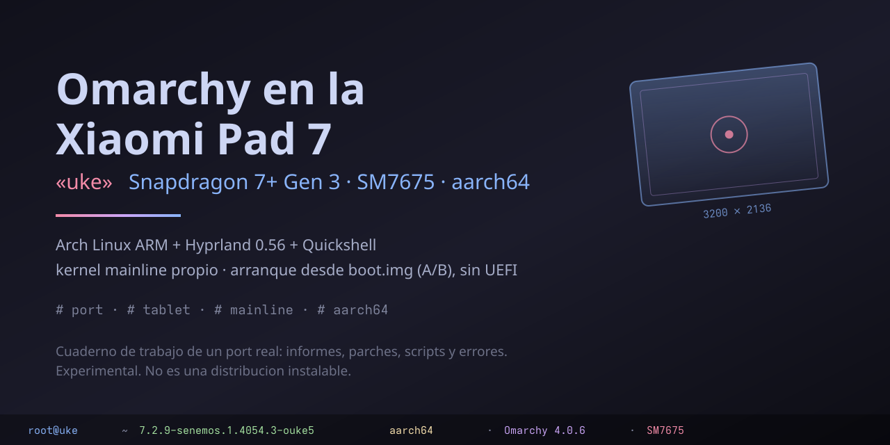

# Omarchy en la Xiaomi Pad 7 «uke» (Snapdragon 7+ Gen 3 / SM7675, aarch64)

> **Instantánea del 23-oct-2026.** El estado del aparato que se describe está verificado en la
> tablet el **22-oct-2026**; el repo público se actualiza a saltos, no en continuo.

Cuaderno de trabajo para llevar **Arch Linux ARM + [Omarchy](https://omarchy.org)** (Hyprland 0.56 con
configuración Lua y shell Quickshell) a la **Xiaomi Pad 7** (nombre en clave `uke`). El kernel es
**mainline propio**: su base es la rama «palawan» de la comunidad
[palawan-mainline](https://codeberg.org/palawan-mainline) (`v7.2-rc2`), sobre la que el proyecto
mantiene su propia rama, **«senemos»** (`7.2.9-senemos.1.4054.3-ouke5` era la que corría en la tablet
el 22-oct-2026). Arranca con el `boot.img` de Android en los slots A/B, sin UEFI ni U-Boot.

> ⚠️ **Ojo con la base, no con la rama.** Las unidades de despliegue condicionan a
> `ConditionKernelVersion=*senemos*`: **7 unidades** (wifi, carga, bt, audio, audio-amps, tapa y
> usb-gadget-late) **se omiten en silencio** en un kernel que no sea de la rama «senemos», y una octava
> (`10-senemos-off.conf`) hace lo contrario. Un kernel «palawan» pelado arranca, pero sin WiFi, sin BT,
> sin audio, sin carga y sin tapa. Ver
> [`HARDWARE.md`](HARDWARE.md) §Kernel y [`BUILD.md`](BUILD.md) §2.

> ⚠️ **Proyecto experimental. No es una distribución lista para instalar.** Es el registro de un port
> hecho a base de ciclos de flasheo, con sus scripts, parches, informes y errores. Seguir los pasos
> sin entenderlos puede dejar la tablet sin arrancar. Úsalo bajo tu responsabilidad (ver `LICENSE`, sin garantía).
>
> ℹ️ **Proyecto personal, no oficial.** No está afiliado a Xiaomi ni a Omarchy; «Xiaomi Pad 7» y
> «Omarchy» son marcas de sus titulares, que se usan aquí solo para describir el aparato y el
> software sobre el que se trabaja.

## Estado (22-oct-2026)

Funciona en la tablet del autor, con el kernel y los **fuentes** de los módulos de este repo
(los `.ko` no se versionan: se compilan aquí, con sus scripts):

- Arranque de Arch ARM desde el slot **`_a`** (`boot_b` queda como rollback), con SSH por USB (RNDIS/NCM).
- Panel, GPU (Adreno 732, freedreno), sesión de Omarchy con Hyprland y Quickshell.
- Táctil y lápiz (Novatek NT36532 + Xiaomi Focus Pen), rotación automática, teclado en pantalla con
  predicción y dictado offline, gestos y capa «escritorio táctil».
- WiFi (WCN6750/ath11k), Bluetooth (A2DP), altavoces internos (FourSemi FS19xx) y micrófono.
- Batería, carga, suspensión (s2idle), sensor de tapa.
- Cámaras traseras y frontal en Megapixels (con autofoco), todavía con fallos (hay un oops abierto).

El estado al día está en [`ESTADO.md`](ESTADO.md); los objetivos y sus criterios de «hecho», en
[`OBJETIVOS.md`](OBJETIVOS.md). La bitácora completa de cada sesión está en [`NOTAS-OMARCHY.md`](NOTAS-OMARCHY.md).

## Qué hay aquí

| Ruta | Contenido |
|---|---|
| [`HARDWARE.md`](HARDWARE.md) | El aparato: SoC, RAM, panel, particiones, slots, ROM base, kernel, módulos |
| [`BUILD.md`](BUILD.md) | Qué se puede reconstruir, qué **no**, y con qué herramientas |
| [`CHANGELOG.md`](CHANGELOG.md) | Cronología del port por fechas (el repo se publica sin historial) |
| [`INDICE-DOCUMENTACION.md`](INDICE-DOCUMENTACION.md) | **El mapa**: dónde está cada cosa |
| `docs/informes/` | Informes de partida (congelados el 26-sep): port a aarch64, arranque, Hyprland/Quickshell, capa tablet, paquetes del SoC |
| `docs/guias/` | Guías de referencia (hallazgos de la revisión nocturna, ida y vuelta Linux↔Android) |
| [`docs/ARQUITECTURA-ARRANQUE.md`](docs/ARQUITECTURA-ARRANQUE.md) | **La cadena de arranque**, eslabón por eslabón: del botón a la sesión de Omarchy |
| `docs/historia/` | Documentos superados (planes v1–v4, runbooks antiguos, `DUDAS-*` respondidos) |
| [`ESTADO.md`](ESTADO.md) | **Una página**: qué funciona, qué no y qué se rompe |
| `REGLAS.md`, `NOTAS-OMARCHY.md`, `OBJETIVOS.md` | Reglas de trabajo con la tablet, bitácora y objetivos medibles |
| `docs/historia/` | Material de trabajo del cuaderno: `AGENTS.md` (instrucciones de trabajo), `DUDAS.md` (bandeja de dudas del dueño), `G-auditoria-documental.md`, `ESTADO-VIVO.md` (bitácora del port) y los planes superados |
| `F-plan-por-fases.md`, `docs/historia/G-auditoria-documental.md` | El plan ejecutable (F0–F8) y el índice maestro del cuaderno |
| `THIRD-PARTY.md` | De dónde viene cada fichero que no es propio y con qué licencia se redistribuye |
| `build/gates/` | Scripts de build, empaquetado de `boot.img`/`dtbo`, verificación, pre-registros e informes de cada ciclo |
| `build/gates/patches/` | Parches del kernel y fuentes de drivers (panel o82, ktz8866, DPU…) |
| `build/kernel-config/` | `.config` de cada kernel probado |
| `build/rootfs/deploy/<tema>/` | Despliegues sobre la tablet: audio, bt, camaras, lapiz, touch-mode, bateria, suspension, wifi, escritorio-tactil, plugins de la shell… (scripts, servicios, QML, C, DTS) |
| `build/pkg/` | PKGBUILD que empaquetan firmware **que tienes que extraer tú** (ver abajo) |
| `charge/` | Scripts y overlays DT de la cadena de carga (ADSP / pmic_glink) |
| `tools/` | Utilidades del repo (`check-links.py` verifica las referencias a ficheros) |

## Qué NO hay (y de dónde sacarlo)

Este repo **no incluye binarios del fabricante ni imágenes**: ni firmware (`.mdt/.bNN/.mbn/.bin`), ni
ACDB de audio, ni el `.fsm` de los amplificadores, ni módulos `.ko`, ni `boot.img`/`dtbo.img`/`vendor_boot`,
ni volcados de Android. Donde un script los necesita, cita su **sha256** y su origen. Para reproducirlo:

1. **ROM oficial de Xiaomi** para la Pad 7 (fastboot ROM HyperOS de la variante `uke`; la usada aquí es
   `OS3.0.303.0.WOZEUXM`). De `NON-HLOS.bin` (partición `modem`, FAT16, se abre con `7z`) salen WPSS
   (WiFi), ADSP y CDSP. Ver la cabecera de `build/pkg/uke-fw-radio/PKGBUILD` y `build/pkg/uke-gpu-firmware/PKGBUILD`.
2. **Tu propia tablet en Android** (con `adb` y, para algunas rutas, root): `vendor`, `odm` y
   `/vendor/firmware_mnt` dan el resto (ACDB, `.fsm` de FS19xx, configs de cámara, calibración de sensores).
   Los informes de `build/rootfs/deploy/audio/` y `camaras/` dicen qué fichero exacto y con qué sha256.
3. **linux-firmware** de Arch para lo que ya es libre (`qca/msbtfw11.mbn`, `ath11k/WCN6750/hw1.0/board-2.bin`).
4. **Kernel**: el árbol base es [MCC45TR/senemos-uke-kernel-mainline](https://github.com/MCC45TR/senemos-uke-kernel-mainline)
   @ `43e4036e` (MIT), y la receta está en
   [`build/gates/senemos/reproducir-arbol.sh`](build/gates/senemos/reproducir-arbol.sh), con la config
   en `build/kernel-config/senemos-ouke5.config` y los parches propios en
   `build/gates/senemos/patches/`. El linaje «palawan» (rama `palawan/v7.2-rc2` de palawan-mainline)
   queda como **histórico**: sus parches están en `build/gates/patches/` y su receta forense en
   `build/gates/BUILD-RECIPE-DORADA.md`.
5. **Omarchy para aarch64**: el repo `edge` de `pkgs.omarchy.org` (el `stable/aarch64` no trae el escritorio).
   Ver `docs/informes/A-port-omarchy-aarch64.md` y `docs/historia/G-auditoria-documental.md` §3.1.

Los paquetes de Arch ARM que se usaron se listan en los manifiestos de `build/rootfs/deploy/omarchy/`.

## Qué puedes hacer hoy (y qué no)

| | |
|---|---|
| ✅ | **Leer y entender** el port: informes, plan, bitácora e informes por ciclo |
| ✅ | **Auditar** los parches del kernel y los overlays DT |
| ✅ | **Reejecutar los despliegues** sobre una tablet que ya tenga Arch: cada `deploy.sh` lleva sus gates (sha256 de lo que instala, vermagic del módulo, firmware presente) |
| ✅ | **Compilar el kernel**: `build/gates/senemos/` reconstruye el árbol, aplica los parches y compila un `Image.gz` con el `.config` publicado (probado: 78 parches del upstream + 5 propios, `olddefconfig` sin cambios y el veredicto del ABL dentro del binario) |
| ⚠️ | **Arrancar la tablet desde cero**: el **árbol del kernel y su `.config` ya se publican** (ver [`BUILD.md`](BUILD.md) §2.2). Faltan el `initramfs` de la variante viva, la **base del `boot.img`** (material del fabricante: se publica cómo sacarla), los 342 `.pkg` de la capa Omarchy y los 56 blobs de firmware |

`make help` da los atajos a los scripts; `make check` corre las mismas comprobaciones que la CI.

## Cómo empezar a leer

1. [`HARDWARE.md`](HARDWARE.md), el aparato: SoC, particiones, slots, kernel.
2. [`BUILD.md`](BUILD.md), **qué se puede reconstruir y qué no** (y por qué). Es el documento que
   decide si esto te sirve.
3. [`INDICE-DOCUMENTACION.md`](INDICE-DOCUMENTACION.md), el mapa de todo lo demás.
4. [`ESTADO.md`](ESTADO.md) y [`build/gates/revision/PENDIENTES-INDICE-20261022.md`](build/gates/revision/PENDIENTES-INDICE-20261022.md),
   qué funciona hoy y qué está bloqueado.
5. `F-plan-por-fases.md`, el plan con el orden y los criterios de «hecho».
6. `REGLAS.md` y `docs/historia/AGENTS.md`, las reglas para no perder la tablet: backup del par `boot`+`dtbo` y sha256
   pre-registrado antes de cada flasheo, `fdtoverlay` antes de cualquier `dtbo` y un cambio por ciclo.
7. [`NOTAS-OMARCHY.md`](NOTAS-OMARCHY.md), la bitácora completa de cada sesión.

## Si lo que quieres es OPERAR, no leer

| Quiero… | Por dónde |
|---|---|
| **Poner Omarchy en la tablet** | [`build/gates/prepara/install-omarchy-uke.sh`](build/gates/prepara/install-omarchy-uke.sh) — el instalador con sus gates (ext4, red, backup, idempotencia). **Es el camino que funciona**; `deploy/omarchy/deploy.sh` (el que cita el `BUILD.md`) necesita 342 `.pkg` que no se publican |
| **Flashear un par boot+dtbo** | [`build/gates/revision/RUNBOOK-FLASH-L76R-20261017.md`](build/gates/revision/RUNBOOK-FLASH-L76R-20261017.md) y [`ROOTFS-L76-8G-20261017.md`](build/gates/revision/ROOTFS-L76-8G-20261017.md) |
| **Reconstruir el kernel** | [`build/gates/senemos/README.md`](build/gates/senemos/README.md) — la receta, con lo que falta dicho |
| **Desbloquear el bootloader** | ⚠️ **El aparato de este port estaba `unlocked`** (`fastboot getvar unlocked` → `yes`). Un aparato de retail necesita el proceso de Xiaomi (Mi Unlock) y su espera. Está en [`docs/informes/B-arranque-arch-uke.md`](docs/informes/B-arranque-arch-uke.md) §«El aparato está unlocked» — y el mismo informe avisa de **no tocar `vbmeta`** |
| **Ver los gates de cada despliegue** | `make deploy-check` (clasifica: OK, necesita tablet, necesita material local, fallo) |

## Notas sobre esta copia

- Se publica **por instantáneas**: el historial del cuaderno original (más de 1000 commits) no está
  aquí, así que los hashes que citan los documentos (y el «ledger» del proyecto hermano
  `ubuntu-permanente`) no se pueden resolver. Lo que sí hay en el historial de Git son las revisiones
  de esta publicación. La cronología del port está en [`CHANGELOG.md`](CHANGELOG.md).
- Las rutas a otros proyectos del autor (`~/proyectos/ubuntu-permanente`, `~/gpu-work`…) son de su máquina
  y no están publicadas. **`~/proyectos/omarchy-uke` es la raíz de este repo**: los scripts lo resuelven
  solos con `git rev-parse --show-toplevel`, así que funcionan recién clonados.
- Datos de red y del aparato anonimizados: IPs → `192.0.2.x` / `100.64.0.x`, MACs → `02:00:5e:00:00:xx`,
  número de serie → `SERIE0001`, SSIDs → `RED-EJEMPLO-n`, contraseñas → `<CONTRASEÑA…>`, nombres de host →
  `PC-PORTATIL` / `SERVIDOR-01`, rutas del entorno original → `/home/USUARIO` y `~/proyectos/<proyecto>`.
  El enlace USB `192.168.42.x` es el real.
- Documentación escrita por el autor con ayuda de herramientas de IA; cada dato lleva su fuente (fichero
  de la tablet, informe o URL) y su fecha de medición.
- La CI (`.github/workflows/ci.yml`) comprueba en cada push que no entren secretos (`gitleaks`), blobs del
  fabricante ni ficheros de más de 10 MiB, que el árbol versionado respete el `.gitignore`, y que las
  referencias a ficheros del repo no se rompan (`tools/check-links.py`).

## Cómo contribuir

Las correcciones a los informes valen más que los informes nuevos: ver [`CONTRIBUTING.md`](CONTRIBUTING.md).
Si encuentras un dato que no debería ser público (token, contraseña, serie, IP real), no abras un issue
público: ver [`SECURITY.md`](SECURITY.md).

## Licencia

[GPL-2.0-or-later](LICENSE), por compatibilidad con el kernel. Los ficheros que vienen de otros proyectos (fuentes del
kernel, topologías de AudioReach, Megapixels, el shell de Omarchy, el diccionario del teclado…) conservan su licencia
original: están listados en [`THIRD-PARTY.md`](THIRD-PARTY.md), que manda sobre la licencia general de este README.
