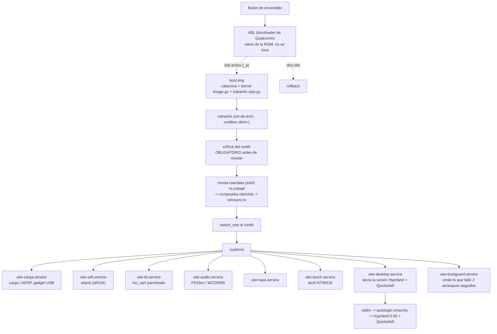

# La cadena de arranque

Cómo pasa de «encender la tablet» a «sesión de Omarchy». Cada eslabón dice qué
fichero lo implementa y qué lo puede parar.

## Los eslabones, en detalle

### 1. ABL → slot

El ABL es el bootloader de Qualcomm de la ROM: **no se reescribe**. Elige el
slot activo (`_a` el 22-oct-2026) y carga su `boot.img`. El `misc` (BCB) lleva
el contador de reintentos por slot; sin marcar el slot con `qbootctl -m`, el ABL
descuenta un reintento en cada arranque y a los 7 marca el slot *unbootable* y
salta al otro slot. Ver [`../build/slot/PROCEDIMIENTO-SLOT.md`](../build/slot/PROCEDIMIENTO-SLOT.md) §3.

### 2. `boot.img`

Lo empaquetan los `repack-*.py` de `build/gates/`. Lleva la cabecera de Android
(`boot_img_hdr`), el `Image.gz` del kernel y el initramfs (`cpio.gz`).

> ⚠️ **No es reproducible desde el repo**: la base es un `boot.img` de la ROM
> que hoy vive en el árbol externo `~/gpu-work/`. Ver [`../BUILD.md`](../BUILD.md) §2.2.

### 3. initramfs: `ukeinit`

`build/gates/ukeinit` es el init del initramfs. Hace, en este orden:

1. **`e2fsck` del rootfs** antes de montar. No es opcional: el `userdata` arrastra
   ~908 errores de ext4 (medido el 26-sep) y sin esto falla el montaje.
2. Monta la raíz en `ro,noload` (para no disparar el journal), comprueba que
   existe `/sbin/init`, y hace `remount,rw`.
3. `switch_root` al rootfs de Arch.

Todo con un *fallback* explícito: si algo falla, se queda en la consola en vez de
dejar la tablet en negro. El `cmdline` (`rdinit=`) va en el `boot.img`.

### 4. rootfs: Arch + Omarchy

El rootfs va en `userdata` (ext4). Lo construye `build/rootfs/mk-rootfs-l76.sh`
sobre una imagen base externa, y encima se aplica la capa de Omarchy
(`build/rootfs/deploy/omarchy/`), que instala los 148 paquetes de
`edge/aarch64` (Hyprland 0.56 con configuración Lua, Quickshell, la shell).

### 5. systemd: las unidades que importan

| Unidad | Qué hace | Condición |
|---|---|---|
| `uke-carga.service` | Carga la cadena de carga (ADSP) y levanta el gadget USB | `*senemos*` |
| `uke-wifi.service` | `wlan0` con ath11k (WCN6750 + WPSS) | `*senemos*` |
| `uke-bt.service` | `hci_uart` parcheado → `hci0` | `*senemos*` |
| `uke-audio.service` / `uke-audio-amps.service` | Altavoces FS19xx (TDM) + micrófono (WCD9395) | `*senemos*` |
| `uke-tapa.service` | Sensor de tapa | `*senemos*` |
| `uke-touch.service` | Táctil NT36532 y lápiz BLE | — |
| `uke-desktop.service` | **Lanza la sesión de Omarchy** | — |
| `uke-bootguard.service` | Omite lo que falló 2 arranques seguidos | — |

⚠️ **Las 7 unidades con `ConditionKernelVersion=*senemos*` se omiten en silencio**
en un kernel de otro linaje: la tablet arranca y no hay WiFi, BT, audio, carga
ni tapa, y no hay aviso. (Una octava, `10-senemos-off.conf`, hace lo contrario:
desactiva el adsp viejo en senemos.) Ver [`../HARDWARE.md`](../HARDWARE.md) §Kernel.

### 6. `uke-bootguard`: la guarda de arranque

`build/rootfs/deploy/arranque/root/usr/local/sbin/uke-bootguard` es una máquina
de estados por componente (`wifi`, `desktop`, `bt`, `audio`, `audio-amps`,
`touch`):

- `begin <n>` (lo llama el `ExecCondition` de cada unidad) marca el intento.
- Si el arranque **no** llega a `ok`, cuenta un fallo.
- A los 2 fallos seguidos, escribe `<n>.tripped` y ese componente **deja de
  arrancar** hasta que alguien haga `uke-bootguard reset <n>`.
- `status` y `reset all` operan sobre los seis nombres.

Protege el arranque, no un cuelgue tardío: un corte de corriente a mitad de
arranque **no** desactiva nada (hacen falta 2 seguidos).

### 7. La sesión

`uke-desktop.service` → `uke-desktop-start` → sddm con autologin del usuario
`omarchy` → Hyprland 0.56 (configuración Lua) + la shell de Quickshell.

## Lo que no está en este diagrama

- Los **módulos propios** (táctil, lápiz, tapa, BT, audio, cámaras): se compilan
  aparte y se cargan como `.ko` desde `extra/`; cada `deploy.sh` lleva su gate de
  vermagic.
- El **`dtbo`**: overlays de device tree que se reempaquetan con `fdtoverlay`
  antes de cada flasheo (regla 1 de `REGLAS.md`).
- La **capa tablet**: rotación, gestos, teclado en pantalla y escritorio táctil,
  que viven en `build/rootfs/deploy/touch-mode/` y `escritorio-tactil/`.
